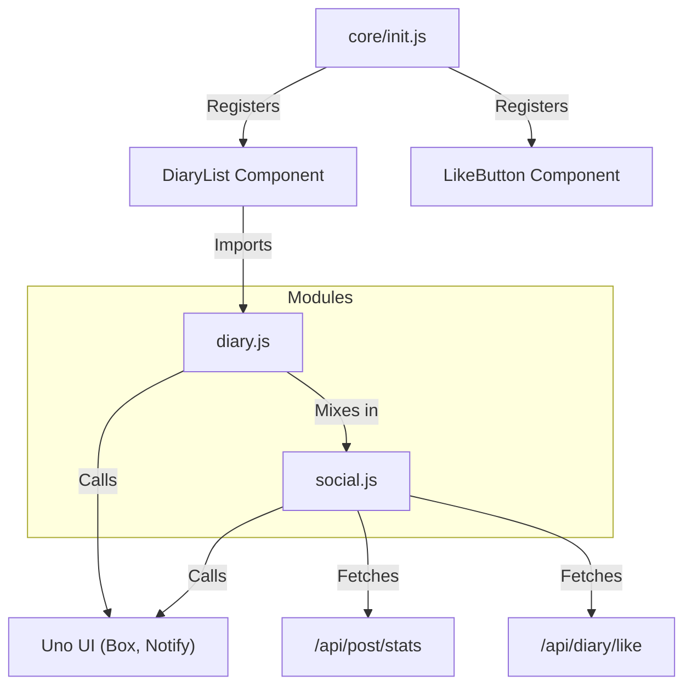
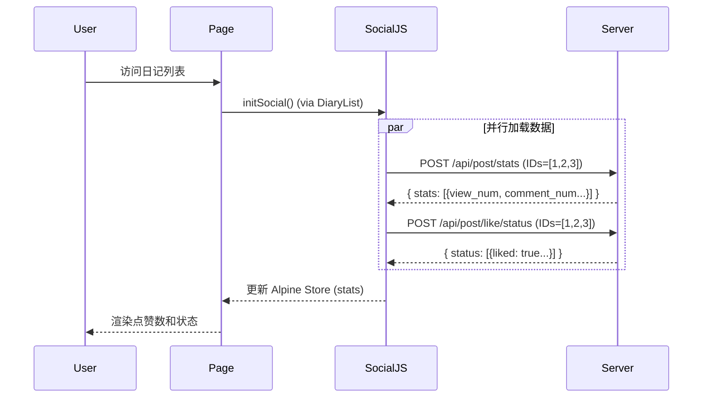

# Hebe 前端架构重构计划：Kiko 迁移至 Uno + HTMX + Alpine + Tailwind v4

**文档版本**: v2.1
**创建日期**: 2025-12-09
**更新日期**: 2025-12-18
**状态**: ✅ 已完成 (Completed)

---

## 1. 现有架构技术评估与重构原则

### 1.1 核心原则 (Key Principles)

本重构计划严格遵循以下原则，以降低风险并确保系统稳定性：

1.  **不向后兼容 (No Backward Compatibility)**: 重构完成后，将彻底移除 `kiko.js`, `jquery.js` 及其相关初始化代码，不保留兼容层。系统将完全运行在现代技术栈上。
2.  **保留 Tailwind CSS v4 (Keep Tailwind v4)**: 继续使用现有的 Tailwind CSS v4 样式体系。不引入 UnoCSS，确保现有 UI 视觉效果 100% 不变。
3.  **服务端接口最小侵入 (Minimal Server Impact)**:
    - **禁止修改** Service 层和 Repository 层逻辑。
    - **禁止修改** 现有的 JSON API 路由和参数结构。
    - **允许微调** Controller 层以支持 **Content Negotiation**（内容协商），即根据请求头（如 `HX-Request`）决定返回 HTML 片段还是完整页面。
4.  **功能与样式零回归 (Zero Regression)**: 重构后的页面在视觉上和功能流程上必须与旧版完全一致。
5.  **CSS 代码保留 (Keep CSS As-Is)**: `/website/static/src/css` 目录下的代码不需要重构。当前基于 Tailwind CSS v4 的样式定义已经是最佳实践，应予以保留并直接复用。
    - **禁止** 在 HTML 模板中添加冗长的内联 Utility Classes (如 `block px-4 py-2...`)，必须优先使用现有的组件类 (如 `.tooltip-link`, `.btn`)。
    - **禁止** 添加新的自定义 CSS，除非确有必要且经过评审。
6.  **JS 代码规范 (Structured JS)**: **禁止在 HTML 模板中编写内联 JavaScript**。所有 JS 逻辑必须位于 `/website/static/src/js` 目录中，通过模块化方式组织。
7.  **Uno 插件优先 (Uno Plugins First)**: 所有通用 UI 交互（如 Tooltip, Dialog, Tabs）必须优先使用或扩展 Uno UI 的插件，禁止在业务代码中重复造轮子。对 Uno 的扩展或修改必须在 `/uno` 项目中进行，编译后供主站使用。
8.  **移动端优先与简洁性 (Mobile-First Simplicity)**: Tailwind CSS v4 本身即是移动端友好的。
    - **禁止** 引入复杂的移动端特定逻辑（如独立的侧边栏 JS、复杂的 Overlay 切换），除非绝对必要。
    - **应使用** 响应式 Utility Classes (如 `hidden md:block`, `w-full md:w-auto`) 来处理布局适配。
    - **避免** 引入不必要的复杂度，保持代码简洁。

### 1.2 重构核心目标

当前重构的核心是通过引入 **Uno UI** (作为核心 UI 框架), **HTMX** (处理服务端交互), **Alpine.js** (处理前端交互) 和 **Tailwind CSS v4** (保持现有样式)，来替换老旧的 `Kiko UI`、`jQuery` 技术栈，实现前端架构的现代化，同时保持视觉和功能的完全一致。

### 1.3 现有架构痛点

- **高耦合**: 业务逻辑通过 `data-action` 属性与 `kiko.js` 中的 jQuery 选择器强绑定。
- **状态混乱**: 状态散落在 DOM 属性中，缺乏统一管理。
- **维护困难**: 每次修改 UI 结构都需要同步修改 JS 里的 DOM 操作代码。

---

## 2. Uno + HTMX + Alpine + Tailwind v4 技术方案

### 2.1 技术选型

- **Uno UI**: 核心 UI 组件库（Dialogs, Notifications, Tabs, Validation），替换 Kiko UI 组件。
  - **部署方式**: 使用已编译文件，路径为 `/website/static/dist/js/uno.umd.js`。
- **HTMX**: 负责与服务端交互（AJAX 替代），处理 HTML 片段的替换与更新。
- **Alpine.js**: 负责纯前端的交互逻辑（如 Dropdown、Modal、Tabs、Toast），替代 jQuery 插件。
- **Tailwind CSS v4**: 保持现状，利用 v4 的即时编译特性。

### 2.2 服务端适配策略

为了在不修改 Service 接口的前提下支持 HTMX，我们将采用 **ViewService 增强模式**：

1.  **请求识别**: 后端通过 `HX-Request` Header 识别 HTMX 请求。
2.  **片段渲染**:
    - **常规请求**: `Render(c, "diary/index", data)` -> 渲染完整 HTML（含 Header/Footer）。
    - **HTMX 请求**: `Render(c, "diary/index", data)` -> 自动识别，仅渲染 `content` 区块的 HTML 片段。
3.  **JSON 接口复用**: 对于必须调用现有 JSON API 的场景（极少数），使用 Alpine.js 发起 `fetch` 请求并处理响应，或使用 HTMX 的 `hx-ext="json-enc"` 扩展。但优先推荐后端 Controller 适配返回 HTML。

### 2.3 前端资源架构 (Frontend Architecture)

我们将重新设计 `/website/static/src/js` 目录结构，以模块化方式组织代码，替代原有的 `app.js` 和 `diary.js`。

**目录结构规划**:

```text
/website/static/src/js/
├── core/               # 核心框架初始化
│   └── init.js         # 初始化 Alpine, HTMX, Uno 配置
├── stores/             # Alpine 全局状态 (Global Stores)
│   ├── theme.js        # 主题管理 (Dark Mode)
│   ├── i18n.js         # 多语言状态管理
│   └── user.js         # 用户登录状态
├── modules/            # 业务模块逻辑 (Alpine Data Components)
│   ├── auth.js         # 登录/注册表单逻辑
│   ├── diary.js        # 日记管理 (CRUD, Modal, 列表交互)
│   ├── social.js       # 社交功能 (点赞, 统计, 评论状态) [NEW]
│   ├── layout.js       # 布局交互 (导航栏, 页脚)
│   ├── member.js       # 用户主页交互
│   └── settings.js     # 用户设置逻辑
└── utils/              # 工具函数
    └── http.js         # 简单的 Fetch 封装 (可选)
```

### 2.5 模块化架构与交互设计 (Modular Architecture & Interaction Design)

为了避免 `diary.js` 过度膨胀，我们将社交相关功能（点赞、统计、评论状态）剥离至独立的 `social.js` 模块，并通过 Mixin 模式与主业务逻辑组合。

#### 2.5.1 模块依赖关系图 (Module Dependency)



#### 2.5.2 社交数据流向图 (Social Data Flow)



#### 2.5.3 关键交互规范 (Critical Interaction Specs)

1.  **日记导航与 URL 路由策略 (Navigation & URL Strategy)**:
    - **场景 A: 列表页打开 (Box Mode)**:
      - **打开 Box**: 点击列表项 -> 打开 Box -> 使用 `history.pushState` 将 URL 变更为 `/p/:id` (方便复制分享)。
      - **Box 内翻页**: 点击 "上一篇/下一篇" -> 触发 HTMX (`hx-get`) -> 更新 Box 内容 -> 使用 `history.pushState` 更新 URL 为新的 `/p/:id`。
      - **关闭 Box**: 关闭 Dialog -> **必须** 还原为打开前的 URL (如 `/d/:id/:page`)，保持列表页上下文。
    - **场景 B: 独立页访问 (Standalone Mode)**:
      - **直接访问**: 浏览器访问 `/p/:id` -> 服务端渲染完整页面 (含 Header/Footer)。
      - **页面导航**: 点击 "上一篇/下一篇" -> 普通 `<a>` 标签跳转 -> 浏览器完整刷新。
    - **实现机制**: 服务端通过 `IsAjax` 变量区分渲染 HTML 片段 (Box) 还是完整布局 (Standalone)。

2.  **评论加载 (Comment Loading)**:
    - **行为**: 详情页加载时懒加载评论。
    - **错误处理**: 服务端返回非 200 或 JSON 错误码时，前端必须捕获并在 Console 记录日志 (避免静默失败)，必要时显示 "加载失败" 占位符。
    - **接口**: `/api/comment/list` (GET)。

3.  **点赞状态 (Like Status)**:
    - **接口**: `/api/diary/like/status` (GET) 和 `/api/post/like/status` (POST, 批量)。
    - **鉴权**: 必须正确处理登录/未登录状态。未登录用户不发送状态查询请求，或服务端返回 `liked: false`。

**资源引用路径**:

- **Uno UI**: `/public/dist/js/uno.umd.js` (对应物理路径 `/website/static/dist/js/uno.umd.js`)
- **App CSS**: `/public/dist/css/idiary.min.css` (对应物理路径 `/website/static/dist/css/idiary.min.css`)

### 2.4 前端构建方案 (Frontend Build Plan)

本重构引入了新的构建流程，需确保构建脚本能够自动化处理以下任务：

1.  **CSS 构建 (CSS Build)**:
    - **策略**: **调整 (Adjusted)**。
    - **说明**: 继续沿用项目现有的 CSS 构建流程（基于 Tailwind CSS v4）。
      - **输入**: `/website/static/src/css` 目录下的源文件。
      - **扫描范围**: 构建脚本必须配置扫描 `/website/static/dist/js/uno.umd.js`，以确保 Uno UI 组件中使用的 Tailwind 类被正确提取和生成。
      - **输出**: `/website/static/dist/css/idiary.min.css`。

2.  **JS 构建 (JS Build)**:
    - **策略**: **模块化打包 (Modular Bundling)**。
    - **说明**: 需要更新构建脚本，支持将 `/website/static/src/js` 下的模块化文件（core, stores, modules, utils）打包处理。
      - **开发环境**: 可直接通过 `<script type="module">` 引用各独立文件以便调试，或使用简单的合并策略。
      - **生产环境**: 需将所有模块打包、压缩为 `app.min.js` (或其他命名)，并输出到 `/website/static/dist/js` 目录。
    - **规范**: 构建过程需支持 ES Module 语法，并确保不破坏代码的执行顺序（如 `core/init.js` 必须最先执行）。

3.  **Uno UI 资源同步 (Uno UI Sync)**:
    - **策略**: **独立编译与引用 (Independent Compilation & Reference)**。
    - **开发工作流**:
      1.  **修改**: 任何 Uno UI 的修改（如修复 Bug 或新增插件功能）必须在 `/Users/yasong.cy/go/src/idiary.ai/hebe/uno` 项目中进行。
      2.  **编译**: 修改完成后，在 `/uno` 目录下运行 `npm run build`，生成最新的 `/uno/dist/uno.umd.js`。
      3.  **同步**: 运行 `npm run build:frontend`，脚本会自动将编译好的文件复制到 `/website/static/dist/js/uno.umd.js`。
    - **引用方式**: 网站前端必须通过 `<script src="/public/dist/js/uno.umd.js">` 引用，**严禁**在业务代码中 import Uno 的源码文件。
    - **源文件**: `/Users/yasong.cy/go/src/idiary.ai/hebe/uno/dist/uno.umd.js`
    - **目标路径**: `/Users/yasong.cy/go/src/idiary.ai/hebe/website/static/dist/js/uno.umd.js`

---

## 3. 分阶段实施路线图 (Phased Roadmap)

采用按**文件目录结构**划分的渐进式重构策略。

### **Phase 1: 基础设施与静态资源 (已完成)**

- **目标**: 建立新老共存的环境，搭建新的 JS 架构。
- **状态**: ✅ 完成
- **主要成果**:
  - 创建了 `static/src/js/core/init.js`，初始化了 Alpine 和 HTMX。
  - 创建了 `theme.js` 和 `i18n.js` stores。
  - 更新了 `header.html` 引用。

### **Phase 2: 公共布局与导航 (已完成)**

- **目标**: 迁移全局导航、页脚和用户菜单，验证 Alpine.js 交互能力。
- **状态**: ✅ 完成
- **涉及文件**: `views/navbar.html`, `views/footer.html`, `static/src/js/modules/layout.js`
- **主要成果**:
  - 重构了 Navbar 用户菜单和移动端菜单。
  - 实现了暗色模式和多语言切换的状态管理。

### **Phase 3: 核心业务 - 浏览与交互 (已完成)**

- **目标**: 重构核心内容浏览页面，包括日记列表、日记详情及用户主页。
- **涉及模块**: `diary`, `post`, `member`
- **对应路由**:
  - `/d/:diaryid` (日记本首页)
  - `/p/:postid` (日记详情页)
  - `/u/:uid` (用户个人主页)

- **任务详情**:

  #### 3.1 日记列表 (Diary List)
  - **文件**: `views/diary/index.html`
  - **JS模块**: `static/src/js/modules/diary.js`
  - [x] **模块化**: 创建 `DiaryList` Alpine 组件。
  - [x] **点赞/删除**: 使用 `Box` 和 `Notify` 组件重构交互。
  - [x] **翻页**: 使用 HTMX 实现无刷新加载。

- **符合度**: 符合设计方案。

  #### 3.2 日记详情 (Post Detail)
  - **文件**: `views/post/detail.html`
  - **路由**: `/p/:postid`
  - **JS模块**: `static/src/js/modules/post.js` (不需要，复用 `diary.js` 组件)
  - [x] **评论加载**: 使用 `hx-get` 懒加载评论列表。
  - [x] **评论提交**: 使用 `hx-post` 提交评论，服务端返回新评论的 HTML 片段。
  - [x] **详情页交互**: 复用 `LikeButton` 组件。
  - [x] **条件导航 (Conditional Navigation)**:
    - **Box 模式**: 当在 Dialog 中查看日记时，"上一篇/下一篇"按钮通过 `hx-get` + `hx-target` 在 Box 内部更新内容，不改变浏览器 URL。
    - **独立页面模式**: 当直接访问 `/p/:id` 时，"上一篇/下一篇"为普通链接，直接跳转。

  #### 3.3 设计一致性审查 (Design Consistency Review)
  - **目标**: 全面检查已重构模块，确保技术实现与设计规范的高度一致性。
  - **审查范围**:
    - 覆盖所有已完成的前端组件、页面和功能模块（Phase 1 & Phase 2 & Phase 3.1-3.2）。
    - 重点验证是否符合文档第1阶段（基础架构）和第2阶段（核心功能）的确立规范。
  - **任务详情**:
    - [x] **规范符合性检查**:
      - 严格对照文档技术要求，审查 HTMX、Alpine.js、UnoCSS 的架构实现。
      - 检查 UI 组件库（Uno UI）的使用一致性，杜绝非标准样式。
    - [x] **问题修正与优化**:
      - 对发现的不符合项进行分类记录（严重/中等/轻微）。
      - 按照优先级顺序执行修正，确保所有修改通过现有测试用例。
      - 更新相关代码注释，确保文档与代码同步。
  - **交付物**:
    - [x] 完整的审查报告（含问题清单和修改记录）。
    - [x] 通过 CI/CD 管道验证的代码库。
    - [x] 更新后的重构计划文档版本。

  #### 3.4 用户主页 (Member Home)
  - **文件**: `views/member/index.html`
  - **路由**: `/u/:uid`
  - **JS模块**: `static/src/js/modules/member.js` (新建)
  - [x] **创建日记本 (Add Notebook)**:
    - 将 `data-action="showDiaryBox"` 替换为 Alpine 点击事件。
    - 交互: 点击触发 `Box.dialog({ ajaxUrl: '/form/diary' })`。
    - 提交: 表单提交后使用 HTMX 或 Fetch 刷新日记本列表。
  - [x] **日记本列表 (Diary Grid)**:
    - 重构 `data-action` 绑定的操作（编辑、删除）。
    - 迁移至 `DiaryList` 组件或新建 `MemberProfile` 组件管理。
  - [x] **个人信息 (Profile)**: - 静态展示为主，如有 "编辑" 按钮，链接至 `/u/settings`。
        | **FIX-03** | **API 接口恢复 (API Fix)** | High | ⏳ 待验证 | 恢复 `GET /api/diary/like/status`；恢复 `GET /api/post/like/status`。 |
        | **FIX-04** | **评论错误处理 (Error Handling)** | Medium | ⏳ 待验证 | 接口非 200 时 Console 报错，UI 显示"加载失败"。 |
        | **FIX-05** | **回归测试 (Regression Test)** | High | ⏳ 待执行 | 通过 TC-301 至 TC-305 所有测试用例。 |

- **目标**: 处理最复杂的表单交互，验证服务端校验反馈机制。
- **涉及模块**: `auth`, `post`, `member`
- **对应路由**:
  - `/login`, `/register` (认证)
  - `/form/post` (写日记/编辑日记)
  - `/u/settings` (用户设置)

- **任务详情**:
- **目标**: 处理复杂表单交互 (登录、注册、写日记、设置)。

  #### 4.1 认证与通行证 (Passport)
  - **对应路由** (基于 `internal/app/controller/user/routes.go`):
    - `GET /login`: 渲染登录页。
    - `POST /login`: 提交登录 (JSON/Form)。
    - `GET /register`: 渲染注册页。
    - `POST /register`: 提交注册。
    - `POST /check-username`: 检查用户名是否占用。
    - `POST /check-email`: 检查邮箱是否占用。
    - `GET/POST /findpwd`: 找回密码。
    - `GET/POST /resetpwd`: 重置密码。
    - `GET /activateuser`: 激活用户。

  - **涉及文件**:
    - `website/views/passport/*.html`
    - `website/static/src/js/modules/auth.js` (新建)

  - **重构任务**:
    - [x] **登录 (Login)**:
      - 改造 `views/passport/login.html`。
      - 使用 `hx-post="/login"` 提交表单。
      - **错误处理**: 监听 `htmx:responseError` 或解析返回的 HTML 错误片段，在前端显示错误提示 (Alert/Toast)。
    - [x] **注册 (Register)**:
      - 改造 `views/passport/register.html`。
      - **实时验证**: `username` 和 `email` 输入框添加 `hx-post="/check-username" hx-trigger="blur"`，服务端需返回简单的验证状态 HTML (如 `<span class="text-red-500">已占用</span>`)。
      - **表单提交**: 使用 `hx-post="/register"`。
    - [x] **找回密码 (Find Password)**:
      - 统一使用 HTMX 处理表单提交 (`findpwd.html`)，避免页面全刷新。
      - 集成 Uno Valid 插件进行表单验证。
    - [x] **重置密码 (Reset Password)**:
      - 重构 `resetpwd.html` 使用 HTMX + Alpine Valid 插件。
      - 保持原有复杂验证逻辑 (`valid` 属性)。

#### 4.2 用户中心 (Member / Settings)

- **对应路由**:
  - `GET /u/settings` (设置页)
  - `POST /u/settings/profile` (更新资料)
  - `POST /u/settings/email` (更新邮箱)
  - `POST /u/settings/password` (修改密码)
- **涉及文件**:
  - `website/views/member/settings.html`
  - `website/static/src/js/modules/settings.js` (新建)
- **重构任务**:
  - [x] **资料设置**:
    - 将 `settings.html` 拆分为独立的 HTMX 表单区域 (Profile, Email, Password)。
    - 使用 `hx-post="/u/settings/profile"` 更新资料，服务端支持返回更新后的 HTML 或 OOB 消息。
  - [x] **交互反馈**:
    - 集成 Uno `Toast` 组件，在 `hx-on::after-request` 中显示 "保存成功" 提示。
  - [x] **头像展示**:
    - 保持原有的文本头像 (首字符) 展示逻辑，不添加图片上传功能。

#### 4.3 内容创作 (Post)

- **对应路由**:
  - `GET /form/post`: 获取编辑器 HTML。
  - `POST /post`: 保存/发布日记。
  - `POST /post/delete`: 删除日记。
- **涉及文件**: `website/views/form/post.html`
- **重构任务**:
  - [x] **编辑器初始化**:
    - 使用原生 Textarea + Alpine `x-validate` 进行验证。
  - [x] **草稿与发布**:
    - 目前仅支持直接发布/保存 (`post.create` / `post.edit`)。
    - 表单提交由 `diary.js` 中的 `_handlePostSubmit` 接管，使用 `fetch` 提交以支持复杂的后续 UI 更新。
  - [x] **成功回调**:
    - 保存成功后，直接在 DOM 中 Prepend/Replace 帖子卡片，无需全页刷新。
- **功能**: 资料修改、头像预览、密码修改。

#### 4.4 清理代码 (已完成)

- [x] 移除 `kiko` 和 `jquery` 依赖
  - [x] 删除 `website/static/src/js/kiko-init.js` 等旧文件
  - [x] 删除 `website/static/dist/js/kiko.min.js` 等构建产物
  - [x] 更新 `package.json` 移除旧构建脚本
- [x] 清理 `data-action` 属性 (已确认代码中无残留)
- [x] 调整 `scripts/build/build.js` (已移除，使用 build-new-frontend.js)
- [x] 全站回归测试 (Unit Tests Passed, Build Verified)

---

## 4. 测试策略总纲 (Testing Strategy Overview)

> **注意**: 具体的测试用例已分散至上述各个阶段的“验证与测试”环节中。本节仅概述使用的工具和通用方法。

### 4.1 工具链

- **Jest**: 用于 JavaScript 模块的单元测试 (Unit Testing)。
- **Playwright/Puppeteer**: 用于自动化视觉回归测试（截图对比）和端到端（E2E）功能测试。
- **Chrome DevTools**: 用于开发过程中的手动验证（Console, Network, Elements）。

### 4.2 核心测试类型

- **单元测试 (Unit Testing)**: 验证 Alpine 组件 (`layout.js`, `diary.js`) 的逻辑正确性。
- **视觉回归 (Visual Regression)**: 像素级对比重构前后的页面截图，确保样式零差异。
- **功能验证 (Functional Verification)**: 验证交互逻辑（点击、提交、弹窗）是否符合预期。
- **接口验证 (API Verification)**: 确保 HTMX 请求正确发送 `HX-Request` 头，且服务端正确返回 HTML 片段。

---
