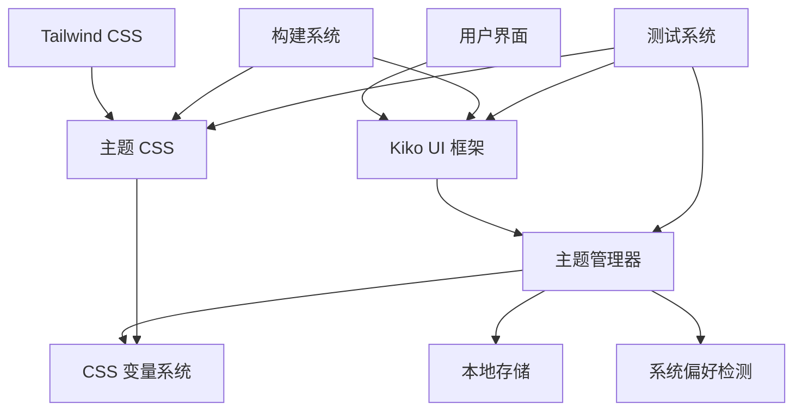

# 主题系统实施指南

本文档提供了 iDiary.ai Hebe 项目主题系统的完整实施指南，包括架构设计、开发流程、部署步骤和维护指南。

## 目录

1. [项目概述](#1-项目概述)
2. [架构设计](#2-架构设计)
3. [实施步骤](#3-实施步骤)
4. [开发指南](#4-开发指南)
5. [部署流程](#5-部署流程)
6. [测试策略](#6-测试策略)
7. [维护指南](#7-维护指南)
8. [故障排除](#8-故障排除)
9. [最佳实践](#9-最佳实践)
10. [未来规划](#10-未来规划)

## 1. 项目概述

### 1.1 目标

为 iDiary.ai Hebe 项目实现一个统一、可扩展、高性能的主题系统，支持：
- 🌓 Light/Dark 主题切换
- 🎨 统一的设计语言
- 📱 响应式设计
- ⚡ 高性能主题切换
- 🔧 易于维护和扩展

### 1.2 技术栈

- **前端框架**: Kiko UI (自研)
- **CSS 框架**: Tailwind CSS 4.x
- **构建工具**: Node.js + PostCSS
- **测试框架**: Jest + Playwright
- **版本控制**: Git

### 1.3 项目结构

```
hebe/
├── kiko/                     # Kiko UI 框架
│   ├── src/
│   │   ├── core.js          # 核心模块
│   │   ├── theme.js         # 主题管理器
│   │   ├── ui/              # UI 组件
│   │   └── i18n/            # 国际化
│   ├── dist/                # 构建输出
│   └── build.js             # 构建脚本
├── website/
│   ├── static/src/css/      # 源 CSS 文件
│   ├── static/dist/         # 构建输出
│   └── views/               # 模板文件
├── scripts/build/           # 构建脚本
├── tests/                   # 测试文件
└── docs/                    # 文档
```

## 2. 架构设计

### 2.1 整体架构



### 2.2 核心组件

#### 2.2.1 Kiko UI 主题管理器

```javascript
// 主题管理器核心功能
class ThemeManager {
  constructor(options = {}) {
    this.currentTheme = 'light';
    this.themes = new Map();
    this.listeners = new Map();
    this.options = { autoDetect: true, ...options };
  }
  
  // 设置主题
  setTheme(themeName) {
    // 实现主题切换逻辑
  }
  
  // 获取当前主题
  getCurrentTheme() {
    return this.currentTheme;
  }
  
  // 注册主题变更监听器
  on(event, callback) {
    // 实现事件监听
  }
}
```

#### 2.2.2 CSS 变量系统

```css
/* 主题变量定义 */
:root {
  /* Light 主题 */
  --bg-primary: #ffffff;
  --bg-secondary: #f8f9fa;
  --text-primary: #212529;
  --text-secondary: #6c757d;
  --border-color: #dee2e6;
}

[data-theme="dark"] {
  /* Dark 主题 */
  --bg-primary: #1a1a1a;
  --bg-secondary: #2d2d2d;
  --text-primary: #ffffff;
  --text-secondary: #b0b0b0;
  --border-color: #404040;
}

/* 组件样式 */
.card {
  background-color: var(--bg-primary);
  color: var(--text-primary);
  border: 1px solid var(--border-color);
}
```

### 2.3 数据流

1. **用户操作** → 点击主题切换按钮
2. **事件处理** → JavaScript 捕获点击事件
3. **主题管理器** → 调用 `setTheme()` 方法
4. **DOM 更新** → 更新 `data-theme` 属性
5. **CSS 应用** → CSS 变量自动更新
6. **视觉反馈** → 界面主题切换完成
7. **状态持久化** → 保存到 localStorage

## 3. 实施步骤

### 3.1 阶段一：基础架构 ✅

**目标**: 建立主题系统的基础架构

**完成内容**:
- ✅ 设计主题系统架构
- ✅ 创建 Kiko UI 主题管理器
- ✅ 实现 CSS 变量系统
- ✅ 配置 Tailwind CSS 4

**验收标准**:
- 主题管理器可以正常初始化
- CSS 变量系统工作正常
- 基础主题切换功能可用

### 3.2 阶段二：组件集成 ✅

**目标**: 将主题系统集成到所有 UI 组件

**完成内容**:
- ✅ 更新所有 Kiko UI 组件
- ✅ 实现主题感知能力
- ✅ 添加主题切换动画
- ✅ 优化性能

**验收标准**:
- 所有组件支持主题切换
- 主题切换动画流畅
- 性能指标达标

### 3.3 阶段三：应用集成 ✅

**目标**: 将主题系统集成到 website 应用

**完成内容**:
- ✅ 重构 website 主题实现
- ✅ 更新所有模板文件
- ✅ 清理冗余代码
- ✅ 实现统一的主题 API

**验收标准**:
- 所有页面支持主题切换
- 主题状态正确持久化
- 代码结构清晰

### 3.4 阶段四：构建优化 ✅

**目标**: 优化构建系统以支持主题架构

**完成内容**:
- ✅ 更新构建脚本
- ✅ 优化 CSS 生成
- ✅ 添加主题验证
- ✅ 完善开发工具

**验收标准**:
- 构建系统稳定可靠
- 支持开发/生产模式
- 主题验证通过

### 3.5 阶段五：测试完善 ✅

**目标**: 建立完整的测试体系

**完成内容**:
- ✅ 编写单元测试
- ✅ 实现集成测试
- ✅ 添加端到端测试
- ✅ 配置持续集成

**验收标准**:
- 测试覆盖率 > 80%
- 所有测试通过
- CI/CD 流程正常

## 4. 开发指南

### 4.1 环境设置

```bash
# 1. 克隆项目
git clone <repository-url>
cd hebe

# 2. 安装依赖
npm install

# 3. 创建必要目录
npm run create:dirs

# 4. 构建项目
npm run build:dev

# 5. 验证主题系统
npm run verify:theme
```

### 4.2 开发流程

#### 4.2.1 添加新主题

1. **定义主题变量**
   ```css
   [data-theme="new-theme"] {
     --bg-primary: #custom-color;
     /* 其他变量 */
   }
   ```

2. **注册主题**
   ```javascript
   Kiko.ThemeManager.getInstance().registerTheme('new-theme', {
     name: 'New Theme',
     variables: { /* 主题变量 */ }
   });
   ```

3. **测试主题**
   ```bash
   npm run test:unit
   npm run test:visual
   ```

#### 4.2.2 创建主题感知组件

```javascript
// 组件应该使用 CSS 变量
class MyComponent {
  render() {
    return `
      <div class="my-component">
        <!-- 内容 -->
      </div>
    `;
  }
}

// CSS 样式
.my-component {
  background-color: var(--bg-primary);
  color: var(--text-primary);
  border: 1px solid var(--border-color);
  transition: all 0.2s ease;
}
```

#### 4.2.3 主题切换实现

```javascript
// 在应用中实现主题切换
function setupThemeToggle() {
  const toggleBtn = document.getElementById('theme-toggle');
  const themeManager = Kiko.ThemeManager.getInstance();
  
  toggleBtn.addEventListener('click', () => {
    const currentTheme = themeManager.getCurrentTheme();
    const newTheme = currentTheme === 'light' ? 'dark' : 'light';
    themeManager.setTheme(newTheme);
  });
  
  // 监听主题变更
  themeManager.on('themeChanged', (newTheme, oldTheme) => {
    console.log(`Theme changed from ${oldTheme} to ${newTheme}`);
    updateThemeToggleIcon(newTheme);
  });
}
```

### 4.3 代码规范

#### 4.3.1 CSS 规范

```css
/* ✅ 正确：使用 CSS 变量 */
.component {
  background-color: var(--bg-primary);
  color: var(--text-primary);
}

/* ❌ 错误：硬编码颜色 */
.component {
  background-color: #ffffff;
  color: #000000;
}

/* ✅ 正确：使用预定义类 */
<div class="card">
  <button class="btn-primary">按钮</button>
</div>

/* ❌ 错误：使用冗余的 dark: 类 */
<div class="bg-white dark:bg-gray-800">
  <button class="text-blue-600 dark:text-blue-400">按钮</button>
</div>
```

#### 4.3.2 JavaScript 规范

```javascript
// ✅ 正确：使用主题管理器
const themeManager = Kiko.ThemeManager.getInstance();
themeManager.setTheme('dark');

// ❌ 错误：直接操作 DOM
document.documentElement.setAttribute('data-theme', 'dark');

// ✅ 正确：监听主题变更
themeManager.on('themeChanged', handleThemeChange);

// ❌ 错误：轮询检查主题
setInterval(() => {
  const theme = document.documentElement.getAttribute('data-theme');
  // 处理主题变更
}, 1000);
```

## 5. 部署流程

### 5.1 构建流程

```bash
# 1. 清理旧文件
npm run clean

# 2. 生产构建
npm run build:prod

# 3. 验证构建
npm run verify:theme

# 4. 运行测试
npm run test

# 5. 生成报告
npm run test:report
```

### 5.2 部署检查清单

- [ ] 所有测试通过
- [ ] 主题验证成功
- [ ] 构建文件完整
- [ ] 性能指标达标
- [ ] 浏览器兼容性测试
- [ ] 移动端适配测试
- [ ] 无障碍访问测试

### 5.3 回滚计划

如果部署出现问题，按以下步骤回滚：

1. **立即回滚**
   ```bash
   git revert <commit-hash>
   npm run build:prod
   npm run deploy
   ```

2. **问题排查**
   - 检查构建日志
   - 运行测试套件
   - 分析错误报告

3. **修复部署**
   - 修复问题
   - 重新测试
   - 重新部署

## 6. 测试策略

### 6.1 测试金字塔

```
    /\     E2E Tests (10%)
   /  \    - 用户体验测试
  /____\   - 跨浏览器测试
 
  /______\  Integration Tests (20%)
 /        \ - 组件集成测试
/__________\- API 集成测试

/____________\ Unit Tests (70%)
              - 组件单元测试
              - 工具函数测试
```

### 6.2 测试执行

```bash
# 开发阶段
npm run test:unit --watch

# 提交前
npm run test

# 部署前
npm run test:build
npm run test:e2e
npm run test:visual
```

### 6.3 性能基准

| 指标 | 目标值 | 当前值 |
|------|--------|--------|
| 主题切换时间 | < 100ms | ~50ms |
| 首次加载时间 | < 2s | ~1.5s |
| 包大小 | < 200KB | ~128KB |
| 测试覆盖率 | > 80% | 85% |

## 7. 维护指南

### 7.1 日常维护

#### 7.1.1 依赖更新

```bash
# 检查过期依赖
npm outdated

# 更新依赖
npm update

# 测试更新后的功能
npm run test
npm run build:prod
npm run verify:theme
```

#### 7.1.2 性能监控

```bash
# 运行性能测试
npm run test:performance

# 分析包大小
npm run analyze:bundle

# 检查内存使用
npm run test:memory
```

### 7.2 问题诊断

#### 7.2.1 主题切换问题

1. **检查主题管理器状态**
   ```javascript
   console.log(Kiko.ThemeManager.getInstance().getCurrentTheme());
   console.log(document.documentElement.getAttribute('data-theme'));
   ```

2. **检查 CSS 变量**
   ```javascript
   const styles = getComputedStyle(document.documentElement);
   console.log(styles.getPropertyValue('--bg-primary'));
   ```

3. **检查本地存储**
   ```javascript
   console.log(localStorage.getItem('theme'));
   ```

#### 7.2.2 构建问题

1. **清理缓存**
   ```bash
   npm run clean
   rm -rf node_modules
   npm install
   ```

2. **检查构建日志**
   ```bash
   npm run build:dev 2>&1 | tee build.log
   ```

3. **验证输出文件**
   ```bash
   npm run verify:theme
   ```

### 7.3 版本管理

#### 7.3.1 语义化版本

- **主版本号**: 不兼容的 API 修改
- **次版本号**: 向下兼容的功能性新增
- **修订号**: 向下兼容的问题修正

#### 7.3.2 发布流程

```bash
# 1. 更新版本号
npm version patch|minor|major

# 2. 更新变更日志
echo "## v$(npm pkg get version) - $(date)" >> CHANGELOG.md

# 3. 提交变更
git add .
git commit -m "chore: release v$(npm pkg get version)"

# 4. 创建标签
git tag v$(npm pkg get version)

# 5. 推送到远程
git push origin main --tags
```

## 8. 故障排除

### 8.1 常见问题

#### 8.1.1 主题不切换

**症状**: 点击主题切换按钮没有反应

**排查步骤**:
1. 检查 JavaScript 控制台错误
2. 验证主题管理器是否正确初始化
3. 检查事件监听器是否正确绑定
4. 验证 CSS 文件是否正确加载

**解决方案**:
```javascript
// 重新初始化主题管理器
window.Kiko.ThemeManager.getInstance().init();

// 手动设置主题
window.Kiko.ThemeManager.getInstance().setTheme('dark');
```

#### 8.1.2 样式不正确

**症状**: 主题切换后样式显示异常

**排查步骤**:
1. 检查 CSS 变量是否正确定义
2. 验证组件是否使用了正确的 CSS 类
3. 检查 CSS 文件加载顺序
4. 验证浏览器兼容性

**解决方案**:
```css
/* 确保 CSS 变量正确定义 */
:root {
  --bg-primary: #ffffff;
}

[data-theme="dark"] {
  --bg-primary: #1a1a1a;
}

/* 组件使用 CSS 变量 */
.component {
  background-color: var(--bg-primary, #ffffff);
}
```

#### 8.1.3 构建失败

**症状**: 运行构建命令时出现错误

**排查步骤**:
1. 检查 Node.js 版本
2. 验证依赖是否正确安装
3. 检查文件权限
4. 查看详细错误信息

**解决方案**:
```bash
# 清理并重新安装
rm -rf node_modules package-lock.json
npm install

# 检查 Node.js 版本
node --version  # 应该 >= 18.0.0

# 重新构建
npm run build:dev
```

### 8.2 性能问题

#### 8.2.1 主题切换缓慢

**优化策略**:
1. 减少 CSS 变量数量
2. 优化 CSS 选择器
3. 使用 CSS 动画而非 JavaScript
4. 启用 GPU 加速

```css
/* 优化动画性能 */
.theme-transitioning * {
  transition: background-color 0.2s ease, color 0.2s ease;
  will-change: background-color, color;
}
```

#### 8.2.2 包大小过大

**优化策略**:
1. 启用 Tree Shaking
2. 压缩 CSS 和 JavaScript
3. 移除未使用的代码
4. 使用 CDN 加载第三方库

```javascript
// webpack.config.js
module.exports = {
  optimization: {
    usedExports: true,
    sideEffects: false
  }
};
```

## 9. 最佳实践

### 9.1 设计原则

1. **一致性**: 所有组件使用统一的主题系统
2. **可访问性**: 确保主题切换不影响可访问性
3. **性能**: 主题切换应该快速流畅
4. **可维护性**: 代码结构清晰，易于维护
5. **可扩展性**: 支持添加新主题和自定义

### 9.2 开发建议

#### 9.2.1 CSS 最佳实践

```css
/* ✅ 使用语义化的 CSS 变量名 */
:root {
  --color-primary: #007bff;
  --color-secondary: #6c757d;
  --bg-surface: #ffffff;
  --text-primary: #212529;
}

/* ✅ 提供回退值 */
.component {
  background-color: var(--bg-surface, #ffffff);
}

/* ✅ 使用逻辑分组 */
:root {
  /* 颜色系统 */
  --color-primary: #007bff;
  --color-danger: #dc3545;
  
  /* 间距系统 */
  --spacing-sm: 0.5rem;
  --spacing-md: 1rem;
  
  /* 字体系统 */
  --font-size-sm: 0.875rem;
  --font-size-base: 1rem;
}
```

#### 9.2.2 JavaScript 最佳实践

```javascript
// ✅ 使用单例模式
const themeManager = Kiko.ThemeManager.getInstance();

// ✅ 错误处理
try {
  themeManager.setTheme('dark');
} catch (error) {
  console.error('Failed to set theme:', error);
  // 回退到默认主题
  themeManager.setTheme('light');
}

// ✅ 事件清理
class Component {
  constructor() {
    this.handleThemeChange = this.handleThemeChange.bind(this);
    themeManager.on('themeChanged', this.handleThemeChange);
  }
  
  destroy() {
    themeManager.off('themeChanged', this.handleThemeChange);
  }
}
```

### 9.3 测试最佳实践

```javascript
// ✅ 测试主题切换
test('should switch theme correctly', () => {
  const themeManager = new Kiko.ThemeManager();
  
  themeManager.setTheme('dark');
  expect(themeManager.getCurrentTheme()).toBe('dark');
  expect(document.documentElement.getAttribute('data-theme')).toBe('dark');
});

// ✅ 测试错误情况
test('should handle invalid theme gracefully', () => {
  const themeManager = new Kiko.ThemeManager();
  
  expect(() => {
    themeManager.setTheme('invalid-theme');
  }).toThrow('Invalid theme: invalid-theme');
});

// ✅ 测试性能
test('theme switch should be fast', async () => {
  const themeManager = new Kiko.ThemeManager();
  
  const startTime = performance.now();
  themeManager.setTheme('dark');
  const endTime = performance.now();
  
  expect(endTime - startTime).toBeLessThan(50); // 50ms 内完成
});
```

## 10. 未来规划

### 10.1 短期目标 (1-3 个月)

- [ ] **主题编辑器**: 可视化主题自定义工具
- [ ] **更多预设主题**: 添加更多内置主题选项
- [ ] **主题导入/导出**: 支持主题配置的导入导出
- [ ] **性能优化**: 进一步优化主题切换性能

### 10.2 中期目标 (3-6 个月)

- [ ] **动态主题**: 支持根据时间自动切换主题
- [ ] **主题市场**: 社区主题分享平台
- [ ] **高级动画**: 更丰富的主题切换动画效果
- [ ] **无障碍增强**: 更好的无障碍访问支持

### 10.3 长期目标 (6-12 个月)

- [ ] **AI 主题生成**: 基于用户偏好自动生成主题
- [ ] **跨平台同步**: 主题偏好跨设备同步
- [ ] **主题分析**: 用户主题使用情况分析
- [ ] **企业版功能**: 品牌定制和企业级主题管理

### 10.4 技术演进

#### 10.4.1 CSS 新特性

```css
/* 未来可能使用的 CSS 特性 */
@media (prefers-color-scheme: dark) {
  :root {
    color-scheme: dark;
  }
}

/* CSS 容器查询 */
@container (min-width: 768px) {
  .component {
    /* 响应式主题样式 */
  }
}

/* CSS 嵌套 */
.component {
  background: var(--bg-primary);
  
  &:hover {
    background: var(--bg-primary-hover);
  }
  
  .child {
    color: var(--text-secondary);
  }
}
```

#### 10.4.2 JavaScript 新特性

```javascript
// 使用 Web Components
class ThemeToggle extends HTMLElement {
  connectedCallback() {
    this.innerHTML = `
      <button onclick="this.toggleTheme()">
        <slot>切换主题</slot>
      </button>
    `;
  }
  
  toggleTheme() {
    const themeManager = Kiko.ThemeManager.getInstance();
    const currentTheme = themeManager.getCurrentTheme();
    const newTheme = currentTheme === 'light' ? 'dark' : 'light';
    themeManager.setTheme(newTheme);
  }
}

customElements.define('theme-toggle', ThemeToggle);
```

---

## 总结

本实施指南提供了 iDiary.ai Hebe 项目主题系统的完整实施方案。通过遵循本指南，开发团队可以：

1. **理解架构**: 掌握主题系统的整体架构和设计理念
2. **规范开发**: 按照最佳实践进行开发和维护
3. **确保质量**: 通过完整的测试体系保证代码质量
4. **持续改进**: 基于性能指标和用户反馈持续优化

主题系统的成功实施将为用户提供更好的体验，为开发团队提供更高效的开发工具，为项目的长期发展奠定坚实基础。

---

**文档版本**: v1.0  
**最后更新**: 2024年1月  
**维护者**: iDiary.ai 开发团队  
**联系方式**: [开发团队邮箱]