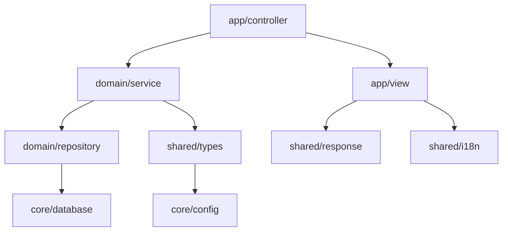

# iDiary.ai Hebe 架构依赖优化分析与建议

## 1. 当前架构分析

### 1.1 现有模块结构

```
internal/
├── core/              # 基础设施层
│   ├── config/        # 配置管理
│   ├── database/      # 数据库连接
│   ├── di/            # 依赖注入容器
│   ├── error/         # 错误处理
│   ├── bootstrap/     # 应用启动
│   ├── middleware/    # 通用中间件
│   └── validation/    # 数据验证
├── shared/            # 共享层
│   ├── contracts/     # 共享接口和类型定义
│   ├── http/          # HTTP响应处理
│   └── i18n/          # 国际化服务
├── domain/            # 领域层（业务逻辑）
│   ├── user/          # 用户领域
│   ├── diary/         # 日记本领域
│   ├── post/          # 日记领域
│   └── task/          # 任务领域
└── app/               # 应用层（表现层）
    ├── bootstrap/     # 应用启动
    ├── controller/    # HTTP控制器
    ├── middleware/    # 应用中间件
    ├── route/         # 路由配置
    ├── templates/     # 模板函数
    └── view/          # 视图服务
```

### 1.2 当前依赖关系分析

基于最新代码结构，当前架构存在以下依赖关系：

#### 正向依赖（符合分层架构）
- `core` ← `shared` ← `domain` ← `app`
- `shared/contracts` 被 `domain` 和 `app` 共同依赖
- `shared/i18n` 被 `app/templates` 和 `app/view` 依赖
- `shared/http` 被 `app/view` 依赖

#### 当前依赖关系详细分析

1. **app层依赖**：
   - `app/controller` → `domain/*` (领域服务)
   - `app/controller` → `app/view` (视图服务)
   - `app/controller` → `shared/contracts` (共享类型)
   - `app/view` → `shared/http`, `shared/i18n`, `shared/contracts` (共享服务)
   - `app/middleware` → `domain/user`, `core/error`, `core/config` (认证和错误处理)
   - `app/route` → `app/controller`, `app/view`, `core/config` (路由配置)

2. **domain层依赖**：
   - `domain/user` → `core/database`, `core/config`, `core/error` (基础设施)
   - `domain/diary` → `core/config`, `core/error` (基础设施)
   - `domain/post` → `core/config`, `core/error` (基础设施)
   - `domain/task` → `core/config`, `core/error` (基础设施)
   - `domain/user` → `domain/task` (跨领域依赖)

3. **shared层依赖**：
   - `shared/i18n` → `core/config` (配置读取)
   - `shared/http` → `core/error` (错误处理)
   - `shared/contracts` 无外部依赖（纯接口定义）

4. **core层依赖**：
   - 各模块之间相互独立，符合基础设施层设计原则

#### 已解决的问题依赖
- ✅ **原 `module` → `app/view` 问题已解决**: 通过重构为 `domain` 层，业务逻辑不再直接依赖视图服务
- ✅ **原 `app/route` → `module` 问题已解决**: 路由层现在通过 `app/controller` 间接调用领域服务

#### 仍需关注的依赖关系
- **`domain/user` → `domain/task`**: 跨领域依赖，需要评估是否合理

## 2. 架构问题分析

### 2.1 当前架构优势

1. **分层架构基本合理**
   - 已实现 `core` ← `shared` ← `domain` ← `app` 的正向依赖
   - 领域层（domain）专注业务逻辑，应用层（app）专注表现逻辑
   - 共享层（shared）提供了良好的横切关注点支持

2. **接口设计较好**
   - `shared/contracts` 提供了清晰的接口定义
   - 使用了泛型提高类型安全性
   - 领域服务通过接口暴露，便于测试和扩展

3. **关注点分离**
   - HTTP响应处理集中在 `shared/http`
   - 国际化服务独立在 `shared/i18n`
   - 视图服务作为门面模式统一管理表现层逻辑

### 2.2 需要关注的问题

1. **跨领域依赖**
   - `domain/user` → `domain/task` 存在跨领域依赖
   - 可能违反领域驱动设计的边界上下文原则

2. **视图服务职责过重**
   - `app/view/service.go` 承担了多种职责：页面数据组装、响应处理、国际化
   - 虽然使用了门面模式，但可能存在职责过于集中的问题

3. **依赖注入可以优化**
   - 部分服务创建逻辑可以进一步抽象
   - 可以考虑更完善的依赖注入策略

### 2.3 影响分析

1. **积极影响**
   - 架构清晰，易于理解和维护
   - 测试友好，接口化设计便于Mock
   - 扩展性良好，支持多种表现形式

2. **潜在风险**
   - 跨领域依赖可能导致领域边界模糊
   - 视图服务过于复杂可能影响单一职责原则
   - 需要持续关注架构演进方向

## 3. 优化方案

基于当前架构分析，提出以下优化建议，按优先级排序：

### 3.1 **高优先级**: 解决跨领域依赖问题

**目标**: 解决 `domain/user` → `domain/task` 的跨领域依赖，保持领域边界清晰。

#### 3.1.1 问题分析

当前 `domain/user/service.go` 直接导入 `domain/task`，这违反了领域驱动设计的边界上下文原则。

#### 3.1.2 解决方案

**方案一：领域事件（推荐）**

```go
// shared/contracts/events.go
type DomainEvent interface {
    EventType() string
    AggregateID() string
    OccurredOn() time.Time
}

type EventBus interface {
    Publish(event DomainEvent) error
    Subscribe(eventType string, handler EventHandler) error
}

type EventHandler interface {
    Handle(event DomainEvent) error
}
```

**方案二：应用服务协调**

在 `app` 层创建应用服务来协调多个领域：

```go
// app/service/user_application_service.go
type UserApplicationService struct {
    userService user.ServiceInterface
    taskService task.ServiceInterface
}

func (s *UserApplicationService) RegisterUser(req RegisterRequest) error {
    // 1. 创建用户
    user, err := s.userService.Register(req)
    if err != nil {
        return err
    }
    
    // 2. 创建默认任务
    return s.taskService.CreateDefaultTasks(user.ID)
}
```

#### 3.1.3 实施步骤

1. **第一步**: 分析 user 和 task 之间的具体依赖关系
2. **第二步**: 选择合适的解耦方案（推荐领域事件）
3. **第三步**: 实现事件总线或应用服务
4. **第四步**: 重构 `domain/user` 移除对 `domain/task` 的直接依赖
5. **第五步**: 编写测试验证重构效果

**预期效果**:
- ✅ 保持领域边界清晰
- ✅ 提高领域模块的独立性
- ✅ 便于未来领域扩展

### 3.2 **重点优化**: 视图服务职责分离重构

**目标**: 对 `app/view` 服务进行职责分离重构，提高单一职责原则的遵循度和代码的可维护性。

#### 3.2.1 当前问题分析

`app/view/service.go` 中的 `ViewService` 存在职责过于集中的问题：

**职责混合问题**：
- 页面数据组装（PageData、BuildPageData、buildRenderContext）
- HTTP响应处理（JSON、HTML、Redirect 系列方法）
- 国际化管理（通过 i18nManager）
- 依赖管理（responseHandler、config）

**具体问题**：
1. **单一职责原则违反**：一个服务承担了数据组装、响应处理、国际化等多种职责
2. **测试复杂度高**：需要 Mock 多种依赖才能进行单元测试
3. **扩展性受限**：新增响应类型或数据组装逻辑都需要修改同一个服务
4. **代码内聚性低**：不同类型的方法混合在一个结构体中

#### 3.2.2 职责分离重构方案

**核心设计思想**：将 `ViewService` 拆分为职责单一的独立服务，通过组合模式提供统一接口。

**方案架构**：

```go
// app/view/interfaces.go

// 页面数据服务接口
type PageDataService interface {
    // 构建页面数据
    BuildPageData(c *gin.Context, titleKey string, data interface{}) *types.PageData[interface{}]
    // 构建渲染上下文
    BuildRenderContext(c *gin.Context) *types.RenderContext
    // 创建简单页面数据（保持向后兼容）
    PageData(c *gin.Context, titleKey string) *types.PageData[map[string]interface{}]
}

// HTTP响应服务接口
type ResponseService interface {
    // JSON响应
    JSON(c *gin.Context, code int, data interface{})
    JSONSuccess(c *gin.Context, data interface{})
    JSONError(c *gin.Context, err error, data ...interface{})
    
    // HTML响应
    HTML(c *gin.Context, name string, data interface{})
    HTMLError(c *gin.Context, title, message string)
    
    // 重定向
    Redirect(c *gin.Context, url string)
}

// 国际化服务接口
type I18nService interface {
    GetMessage(key, lang string) string
    GetLocaleFromContext(c *gin.Context) string
}

// 统一视图服务接口（组合接口）
type ViewServiceInterface interface {
    PageDataService
    ResponseService
}
```

**具体实现**：

```go
// app/view/page_data_service.go
type pageDataService struct {
    config      *config.Config
    i18nService I18nService
}

func NewPageDataService(cfg *config.Config, i18n I18nService) PageDataService {
    return &pageDataService{
        config:      cfg,
        i18nService: i18n,
    }
}

func (s *pageDataService) BuildPageData(c *gin.Context, titleKey string, data interface{}) *types.PageData[interface{}] {
    ctx := s.BuildRenderContext(c)
    title := s.i18nService.GetMessage(titleKey, ctx.Lang)
    
    return &types.PageData[interface{}]{
        Title:   title,
        Context: ctx,
        Data:    data,
    }
}

func (s *pageDataService) BuildRenderContext(c *gin.Context) *types.RenderContext {
    lang := s.i18nService.GetLocaleFromContext(c)
    
    isLogin := false
    var authUser *types.AuthUser
    if isLoginValue, exists := c.Get("IsLogin"); exists {
        isLogin = isLoginValue.(bool)
    }
    if authUserValue, exists := c.Get("AuthUser"); exists && authUserValue != nil {
        if user, ok := authUserValue.(*types.AuthUser); ok {
            authUser = user
        }
    }
    
    return &types.RenderContext{
        IsLogin:  isLogin,
        AuthUser: authUser,
        Lang:     lang,
    }
}

func (s *pageDataService) PageData(c *gin.Context, titleKey string) *types.PageData[map[string]interface{}] {
    ctx := s.BuildRenderContext(c)
    title := s.i18nService.GetMessage(titleKey, ctx.Lang)
    
    return &types.PageData[map[string]interface{}]{
        Title:   title,
        Context: ctx,
        Data:    make(map[string]interface{}),
    }
}
```

```go
// app/view/response_service.go
type responseService struct {
    handler response.HandlerInterface
}

func NewResponseService(handler response.HandlerInterface) ResponseService {
    return &responseService{
        handler: handler,
    }
}

func (s *responseService) JSON(c *gin.Context, code int, data interface{}) {
    s.handler.JSON(c, code, data)
}

func (s *responseService) JSONSuccess(c *gin.Context, data interface{}) {
    s.handler.JSONSuccess(c, data)
}

func (s *responseService) JSONError(c *gin.Context, err error, data ...interface{}) {
    s.handler.JSONError(c, err, data...)
}

func (s *responseService) HTML(c *gin.Context, name string, data interface{}) {
    s.handler.HTML(c, name, data)
}

func (s *responseService) HTMLError(c *gin.Context, title, message string) {
    s.handler.HTMLError(c, title, message)
}

func (s *responseService) Redirect(c *gin.Context, url string) {
    s.handler.Redirect(c, url)
}
```

```go
// app/view/i18n_service.go
type i18nService struct {
    manager i18n.I18nManager
}

func NewI18nService(manager i18n.I18nManager) I18nService {
    return &i18nService{
        manager: manager,
    }
}

func (s *i18nService) GetMessage(key, lang string) string {
    return s.manager.GetMessage(key, lang)
}

func (s *i18nService) GetLocaleFromContext(c *gin.Context) string {
    return s.manager.GetLocaleFromContext(c)
}
```

```go
// app/view/service.go (重构后的组合服务)
type ViewService struct {
    PageDataService
    ResponseService
}

func NewViewService(pageData PageDataService, response ResponseService) ViewServiceInterface {
    return &ViewService{
        PageDataService: pageData,
        ResponseService: response,
    }
}
```

#### 3.2.3 依赖注入配置

```go
// core/di/container.go (更新依赖注入配置)
func (c *Container) registerViewServices() {
    // 注册国际化服务
    c.container.Provide(view.NewI18nService)
    
    // 注册页面数据服务
    c.container.Provide(view.NewPageDataService)
    
    // 注册响应服务
    c.container.Provide(view.NewResponseService)
    
    // 注册组合视图服务
    c.container.Provide(view.NewViewService)
}
```

#### 3.2.4 重构优势

**技术优势**：
1. **单一职责**：每个服务只负责一种类型的操作
2. **易于测试**：可以独立测试每个服务，减少 Mock 复杂度
3. **高内聚低耦合**：相关功能聚合在一起，服务间依赖清晰
4. **易于扩展**：新增功能只需要扩展对应的服务
5. **向后兼容**：保持原有接口不变，现有代码无需修改

**维护优势**：
1. **代码组织清晰**：按职责分离，便于定位和修改
2. **团队协作友好**：不同开发者可以并行开发不同服务
3. **错误隔离**：一个服务的问题不会影响其他服务

#### 3.2.5 实施步骤

**第一步：创建新的服务接口**（1天）
1. 创建 `app/view/interfaces.go` 定义各服务接口
2. 确保接口设计符合单一职责原则

**第二步：实现独立服务**（2-3天）
1. 实现 `PageDataService`
2. 实现 `ResponseService`
3. 实现 `I18nService`
4. 编写对应的单元测试

**第三步：创建组合服务**（1天）
1. 重构 `ViewService` 为组合服务
2. 保持原有接口不变，确保向后兼容

**第四步：更新依赖注入**（1天）
1. 更新 DI 容器配置
2. 确保所有依赖正确注入

**第五步：测试验证**（1-2天）
1. 运行所有现有测试，确保功能正常
2. 编写新的单元测试和集成测试
3. 验证性能没有显著下降

#### 3.2.6 风险控制

**技术风险**：
- **向后兼容性**：通过保持原有接口确保兼容
- **性能影响**：组合模式可能增加轻微开销，但可以接受
- **复杂度增加**：通过清晰的接口设计和文档降低理解成本

**实施风险**：
- **测试覆盖**：确保重构前后功能一致性
- **团队适应**：提供充分的文档和培训
- **渐进迁移**：可以逐步迁移，降低风险

### 3.3 **低优先级**: 完善基础设施层

**目标**: 进一步优化 `shared` 和 `core` 层的设计。

#### 3.3.1 已有优势

1. **✅ 清晰的接口定义**: `shared/contracts` 提供了良好的类型安全性
2. **✅ 模块化设计**: HTTP处理、国际化、配置管理等模块职责清晰
3. **✅ 泛型支持**: 利用Go 1.18+的泛型特性提高类型安全

#### 3.3.2 优化建议

1. **配置管理增强**
   - 支持配置热重载
   - 环境变量覆盖机制
   - 配置验证和默认值处理

2. **错误处理完善**
   - 统一错误码体系
   - 错误链追踪支持
   - 业务异常与系统异常分离

3. **可观测性提升**
   - 结构化日志
   - 性能指标收集
   - 健康检查端点

4. **依赖注入优化**
   - 生命周期管理
   - 循环依赖检测
   - 配置驱动的依赖注入

## 4. 实施计划

### 4.1 第一阶段：视图服务职责分离重构（重点优化）

**时间估算**: 1周

**具体任务**:
1. **接口设计**（1天）
   - 创建 `app/view/interfaces.go`
   - 定义 `PageDataService`、`ResponseService`、`I18nService` 接口
   - 设计组合接口 `ViewServiceInterface`

2. **服务实现**（2-3天）
   - 实现 `pageDataService`（页面数据组装）
   - 实现 `responseService`（HTTP响应处理）
   - 实现 `i18nService`（国际化服务）
   - 重构 `ViewService` 为组合服务

3. **依赖注入配置**（1天）
   - 更新 `core/di/container.go`
   - 配置各服务的依赖注入
   - 确保服务正确组装

4. **测试验证**（1-2天）
   - 编写各服务的单元测试
   - 运行现有测试确保兼容性
   - 验证功能完整性和性能

**预期成果**:
- ✅ 实现职责分离，提高代码可维护性
- ✅ 保持向后兼容，现有代码无需修改
- ✅ 提高测试覆盖率和测试独立性
- ✅ 为后续扩展奠定良好基础

### 4.2 第二阶段：跨领域依赖解耦（可选优化）

**时间估算**: 1-2周（根据需要决定是否实施）

**具体任务**:
1. **依赖分析**（1天）
   - 分析 `domain/user` → `domain/task` 的具体依赖
   - 评估业务影响和重构必要性

2. **方案设计**（2天）
   - 选择领域事件或应用服务方案
   - 设计解耦架构

3. **实施重构**（3-5天）
   - 实现选定的解耦方案
   - 重构相关代码

4. **测试验证**（2天）
   - 验证功能正确性
   - 确保业务逻辑不受影响

### 4.3 第三阶段：基础设施完善（低优先级）

**时间估算**: 根据业务需要安排

**具体任务**:
1. **配置管理增强**
   - 配置热重载
   - 环境变量覆盖

2. **错误处理完善**
   - 统一错误码体系
   - 错误链追踪

3. **可观测性提升**
   - 结构化日志
   - 性能监控

4. **依赖注入优化**
   - 生命周期管理
   - 循环依赖检测

### 4.4 重构方案详细设计

#### 方案一：Controller-Service 分离（推荐）

```
internal/
├── core/              # 基础设施层（不变）
├── shared/            # 共享层（不变）
├── domain/            # 领域层（重命名 module）
│   ├── user/
│   │   ├── service.go      # 纯业务逻辑，返回数据
│   │   ├── repository.go   # 数据访问
│   │   └── types.go        # 领域类型
│   ├── diary/
│   └── post/
└── app/               # 应用层
    ├── controller/         # HTTP 控制器
    │   ├── user.go         # 用户相关路由处理
    │   ├── diary.go        # 日记相关路由处理
    │   └── post.go         # 文章相关路由处理
    ├── view/              # 视图服务（不变）
    ├── route/             # 路由配置
    └── templates/         # 模板函数
```

**核心改变**：
1. `domain` 层只包含纯业务逻辑，不依赖任何表现层
2. `app/controller` 层负责 HTTP 请求处理和视图渲染
3. 控制器调用领域服务获取数据，然后进行视图渲染

#### 方案二：事件驱动架构（适合复杂场景）

```
internal/
├── core/
├── shared/
│   └── events/        # 事件定义
├── domain/            # 领域层
│   ├── user/
│   │   ├── service.go      # 发布领域事件
│   │   ├── events.go       # 用户相关事件
│   │   └── repository.go
│   └── ...
└── app/
    ├── handlers/           # 事件处理器
    │   ├── user_handler.go # 处理用户事件，进行视图渲染
    │   └── ...
    ├── controller/         # 简化的控制器
    └── ...
```

### 3.3 推荐实施方案（方案一详细设计）

#### 3.3.1 领域层重构

```go
// internal/domain/user/service.go
type Service struct {
    repo RepositoryInterface
    auth AuthHelperInterface
}

// 纯业务逻辑，返回数据而非渲染视图
func (s *Service) GetUserProfile(userID int64) (*UserProfile, error) {
    // 业务逻辑处理
    return profile, nil
}

func (s *Service) CreateUser(req *CreateUserRequest) (*User, error) {
    // 业务逻辑处理
    return user, nil
}
```

#### 3.3.2 应用层控制器

```go
// internal/app/controller/user.go
type UserController struct {
    userService   domain_user.ServiceInterface
    viewService   view.ViewServiceInterface
}

func (c *UserController) ShowUserProfile(ctx *gin.Context) {
    userID := c.parseUserID(ctx.Param("uid"))
    
    // 调用领域服务获取数据
    profile, err := c.userService.GetUserProfile(userID)
    if err != nil {
        c.viewService.JSONError(ctx, err)
        return
    }
    
    // 视图渲染
    data := c.viewService.PageData(ctx, "user.profile.title")
    data.Data["Profile"] = profile
    c.viewService.HTML(ctx, "user/profile", data)
}

func (c *UserController) RegisterRoutes(router *gin.Engine) {
    router.GET("/u/:uid", c.ShowUserProfile)
    // 其他路由...
}
```

#### 3.3.3 路由层简化

```go
// internal/app/route/router.go
func SetWithContainer(server *gin.Engine, container *di.Container) {
    setTemplate(server, config.GetViewsPath(), container)
    setStaticFs(server, config.GetStaticPath())
    
    // 注册控制器路由
    registerControllers(server, container)
}

func registerControllers(server *gin.Engine, container *di.Container) {
    // 创建控制器并注册路由
    userController := createUserController(container)
    userController.RegisterRoutes(server)
    
    diaryController := createDiaryController(container)
    diaryController.RegisterRoutes(server)
    
    postController := createPostController(container)
    postController.RegisterRoutes(server)
}
```

## 5. 风险评估与控制

### 5.1 技术风险

#### 5.1.1 跨领域依赖解耦风险

**风险等级**: 中等

**风险描述**:
- 事件驱动可能引入异步复杂性
- 数据一致性问题
- 调试和排错难度增加

**控制措施**:
1. **渐进式重构**: 先用应用服务方案，后续再考虑事件驱动
2. **完整测试**: 重点测试跨领域的业务场景
3. **监控告警**: 增加业务流程监控
4. **回滚方案**: 保留原有实现作为备选

#### 5.1.2 视图服务重构风险

**风险等级**: 低

**风险描述**:
- 过度设计导致复杂性增加
- 接口变更影响现有代码

**控制措施**:
1. **保持向后兼容**: 新接口不破坏现有调用
2. **分阶段实施**: 先内部重构，再考虑接口变更
3. **充分测试**: 确保所有视图功能正常

### 5.2 业务风险

#### 5.2.1 功能回归风险

**风险等级**: 中等

**风险描述**:
- 重构过程中可能引入功能缺陷
- 用户体验受影响

**控制措施**:
1. **功能测试**: 完整的回归测试套件
2. **灰度发布**: 分批次发布新版本
3. **快速回滚**: 准备快速回滚机制
4. **用户反馈**: 建立用户反馈渠道

#### 5.2.2 性能影响风险

**风险等级**: 低

**风险描述**:
- 新架构可能影响系统性能
- 额外的抽象层增加开销

**控制措施**:
1. **性能基准**: 建立性能基准测试
2. **持续监控**: 监控关键性能指标
3. **优化策略**: 准备性能优化方案

### 5.3 团队风险

#### 5.3.1 学习成本风险

**风险等级**: 低

**风险描述**:
- 团队需要适应新的架构模式
- 开发效率短期内可能下降

**控制措施**:
1. **培训计划**: 组织架构设计培训
2. **文档完善**: 提供详细的开发指南
3. **代码审查**: 加强代码审查和知识分享
4. **渐进过渡**: 给团队充分的适应时间

### 5.4 迁移策略

#### 5.4.1 渐进式迁移

1. **第一阶段**: 重构一个模块（如 user 模块）
   - 创建 `internal/domain/user/` 目录
   - 将业务逻辑从 `handler` 移到 `service`
   - 创建 `app/controller/user.go`
   - 更新路由配置

2. **第二阶段**: 迁移其他模块
   - 按相同模式迁移 diary 和 post 模块
   - 确保测试覆盖

3. **第三阶段**: 清理和优化
   - 删除旧的 `module` 目录
   - 优化依赖注入配置
   - 完善文档

#### 5.4.2 兼容性保证

- 保持 API 路径不变
- 保持模板结构不变
- 保持数据库结构不变
- 渐进式迁移，确保系统稳定性

#### 5.4.3 质量保证

1. **测试策略**
   - 单元测试覆盖率 > 80%
   - 集成测试覆盖核心业务流程
   - 端到端测试验证用户场景

2. **代码质量**
   - 代码审查必须通过
   - 静态代码分析
   - 性能测试验证

3. **发布流程**
   - 预发布环境验证
   - 分批次灰度发布
   - 监控告警机制

## 5. 优化后的架构优势

### 5.1 清晰的分层



### 5.2 核心优势

1. **严格分层**: 依赖关系清晰，单向向下
2. **职责分离**: 业务逻辑与视图渲染完全解耦
3. **可测试性**: 领域服务可独立进行单元测试
4. **可维护性**: 模块职责清晰，易于维护和扩展
5. **可复用性**: 领域服务可被多种表现层复用（Web、API、CLI等）

### 5.3 测试改进

```go
// 领域服务可独立测试
func TestUserService_CreateUser(t *testing.T) {
    mockRepo := &MockUserRepository{}
    service := user.NewService(mockRepo)
    
    user, err := service.CreateUser(&CreateUserRequest{
        Username: "test",
        Email:    "test@example.com",
    })
    
    assert.NoError(t, err)
    assert.Equal(t, "test", user.Username)
}
```

## 6. Facade 模式分析与优化建议

### 6.1 当前 Facade 模式应用分析

#### 6.1.1 ViewService 作为 Facade

当前 `app/view/ViewService` 实现了典型的 Facade 模式：

```go
// ViewService 作为多个子系统的统一门面
type ViewService struct {
    config          *config.Config
    responseHandler *http.Handler     // HTTP响应处理
    i18nManager     i18n.I18nManager  // 国际化服务
}

// 统一的页面数据构建接口
func (s *ViewService) PageData(c *gin.Context, titleKey string) *contracts.PageData[map[string]interface{}]

// 统一的响应处理接口
func (s *ViewService) JSON(c *gin.Context, code int, data interface{})
func (s *ViewService) HTML(c *gin.Context, name string, data interface{})
```

#### 6.1.2 Facade 模式优势

**✅ 简化客户端调用**
- Controller 只需依赖一个 `ViewService`，而不是多个子系统
- 统一的接口风格，降低学习成本
- 隐藏了 i18n、response、config 等子系统的复杂性

**✅ 解耦客户端与子系统**
- Controller 不直接依赖 `shared/http`、`shared/i18n` 等模块
- 子系统变更时，只需修改 Facade 实现
- 便于进行集成测试和 Mock

**✅ 统一的错误处理**
- 在 Facade 层统一处理异常和错误转换
- 提供一致的错误响应格式

#### 6.1.3 当前实现的问题

**⚠️ 职责过于集中**
```go
// ViewService 承担了太多职责
- 页面数据构建 (PageData)
- HTTP响应处理 (JSON/HTML)
- 国际化处理 (i18n)
- 渲染上下文构建 (buildRenderContext)
```

**⚠️ 接口不够内聚**
- `PageData` 和响应处理是两个不同的关注点
- 混合了数据构建和响应渲染的职责

**⚠️ 扩展性受限**
- 新增响应类型需要修改 ViewService
- 难以支持不同的页面数据构建策略

### 6.2 Facade 模式优化方案

#### 6.2.1 方案一：细粒度 Facade（推荐）

将当前的 `ViewService` 拆分为多个专门的 Facade：

```go
// app/facade/response.go - 响应处理门面
type ResponseFacade struct {
    httpHandler *http.Handler
    i18nManager i18n.I18nManager
}

func (f *ResponseFacade) JSON(c *gin.Context, code int, data interface{})
func (f *ResponseFacade) HTML(c *gin.Context, name string, data interface{})
func (f *ResponseFacade) JSONError(c *gin.Context, err error, data ...interface{})

// app/facade/page_data.go - 页面数据构建门面
type PageDataFacade struct {
    i18nManager i18n.I18nManager
    config      *config.Config
}

func (f *PageDataFacade) BuildPageData(c *gin.Context, titleKey string) *contracts.PageData[map[string]interface{}]
func (f *PageDataFacade) BuildTypedPageData[T any](c *gin.Context, titleKey string, data T) *contracts.PageData[T]

// app/facade/render.go - 渲染门面（组合上述两个门面）
type RenderFacade struct {
    Response *ResponseFacade
    PageData *PageDataFacade
}
```

**优势：**
- ✅ 职责单一，每个 Facade 专注一个领域
- ✅ 更好的可测试性和可维护性
- ✅ 支持按需组合，灵活性更高
- ✅ 符合单一职责原则

**劣势：**
- ⚠️ 增加了一定的复杂性
- ⚠️ Controller 需要依赖多个 Facade

#### 6.2.2 方案二：保持现状但优化接口

保持单一 `ViewService` 但优化其接口设计：

```go
// 优化后的 ViewService
type ViewService struct {
    response ResponseFacade  // 组合而非继承
    pageData PageDataFacade
}

// 提供更清晰的接口分组
func (s *ViewService) Response() ResponseFacade
func (s *ViewService) PageData() PageDataFacade

// 保留便捷方法
func (s *ViewService) RenderPage(c *gin.Context, template string, titleKey string, data interface{})
func (s *ViewService) RenderJSON(c *gin.Context, data interface{})
```

**优势：**
- ✅ 保持了简单的客户端接口
- ✅ 内部结构更清晰
- ✅ 向后兼容性好

**劣势：**
- ⚠️ 仍然存在职责集中的问题
- ⚠️ 测试时需要 Mock 整个 ViewService

### 6.3 过度设计风险评估

#### 6.3.1 当前项目规模评估

**项目特征：**
- 中小型 Web 应用
- 3个主要业务模块（user、diary、post）
- 团队规模相对较小
- 业务逻辑相对简单

#### 6.3.2 Facade 模式适用性分析

**✅ 适合使用 Facade 的场景：**
- HTTP 响应处理：涉及多个子系统（http、i18n、error）
- 页面数据构建：需要整合多种上下文信息
- 模板渲染：涉及 i18n、auth、config 等

**⚠️ 可能过度设计的场景：**
- 简单的数据转换操作
- 单一职责的工具函数
- 不涉及多个子系统的操作

#### 6.3.3 推荐策略

**当前阶段（中优先级）：**
1. **保持现有 ViewService**，但进行内部重构
2. **引入接口分组**，提高代码可读性
3. **添加便捷方法**，简化常见操作

**未来扩展（低优先级）：**
1. 当业务复杂度增加时，考虑拆分为细粒度 Facade
2. 当团队规模扩大时，引入更严格的分层

### 6.4 具体实施建议

#### 6.4.1 短期优化（推荐立即实施）

```go
// 1. 在 ViewService 中引入接口分组
type ViewService struct {
    config   *config.Config
    response *ResponseGroup
    pageData *PageDataGroup
}

type ResponseGroup struct {
    handler     *http.Handler
    i18nManager i18n.I18nManager
}

type PageDataGroup struct {
    i18nManager i18n.I18nManager
    config      *config.Config
}

// 2. 提供便捷的组合方法
func (s *ViewService) RenderPage(c *gin.Context, template, titleKey string, data interface{}) {
    pageData := s.pageData.Build(c, titleKey, data)
    s.response.HTML(c, template, pageData)
}
```

#### 6.4.2 中期优化（可选）

如果发现当前方案不够灵活，可以考虑：

1. **引入 app/facade 包**
2. **拆分为专门的 Facade**
3. **使用依赖注入管理 Facade 之间的关系**

#### 6.4.3 评估标准

**何时需要进一步拆分：**
- ViewService 代码行数超过 200 行
- 出现 3 个以上不相关的职责
- 测试变得困难
- 团队成员反馈接口不够清晰

**何时保持现状：**
- 当前实现满足业务需求
- 团队对现有架构熟悉
- 没有明显的维护问题

## 7. 实施建议

### 7.1 优先级排序

1. **高优先级**: 解决跨领域依赖问题
   - **状态**: 待实施
   - **影响**: 架构合规性，领域边界清晰
   - **时间**: 1-2周

2. **中优先级**: 视图服务优化
   - **状态**: 分析完成
   - **结论**: 当前 ViewService 的 Facade 模式实现基本合理
   - **建议**: 采用渐进式优化策略，避免过度设计
   - **时间**: 3-5天

3. **低优先级**: 基础设施完善
   - **状态**: 已完成基础分析
   - **建议**: 根据业务需要逐步完善
   - **时间**: 按需安排

### 7.2 实施原则

#### 7.2.1 技术原则

1. **渐进式演进**: 避免大爆炸式重构
2. **向后兼容**: 保持现有 API 和接口稳定
3. **测试驱动**: 重构前先完善测试
4. **监控优先**: 建立完善的监控体系

#### 7.2.2 质量原则

1. **代码审查**: 所有架构变更都需要代码审查
2. **文档同步**: 及时更新架构文档和开发指南
3. **知识分享**: 定期分享架构设计理念和最佳实践
4. **持续改进**: 根据实际使用情况持续优化

### 7.3 成功标准

#### 7.3.1 技术指标

1. **架构合规性**
   - 消除循环依赖
   - 实现清晰的分层架构
   - 领域边界明确

2. **代码质量**
   - 测试覆盖率 > 80%
   - 代码重复率 < 5%
   - 静态分析无严重问题

3. **性能指标**
   - 响应时间不劣化
   - 内存使用稳定
   - 并发处理能力保持

#### 7.3.2 业务指标

1. **功能完整性**
   - 所有现有功能正常
   - 用户体验无影响
   - 数据一致性保证

2. **开发效率**
   - 新功能开发效率提升
   - 代码维护成本降低
   - 团队协作更顺畅

### 7.4 后续规划

#### 7.4.1 短期目标（1-2个月）

1. 完成跨领域依赖解耦
2. 优化视图服务内部结构
3. 建立完善的测试体系
4. 完善监控和告警

#### 7.4.2 中期目标（3-6个月）

1. 根据业务发展需要扩展架构
2. 引入更多最佳实践
3. 优化性能和可扩展性
4. 完善开发工具链

#### 7.4.3 长期目标（6个月以上）

1. 支持微服务架构演进
2. 引入云原生技术栈
3. 建立完整的 DevOps 流程
4. 实现自动化运维

## 8. 总结

基于对最新 `internal` 代码结构的全面分析，本文档重新评估了 iDiary.ai Hebe 项目的架构依赖优化方案。

### 8.1 当前架构状态评估

**积极方面**:
- ✅ **分层架构合理**: 已实现 `core` ← `shared` ← `domain` ← `app` 的正向依赖
- ✅ **接口设计良好**: `shared/contracts` 提供了清晰的类型安全接口
- ✅ **关注点分离**: HTTP处理、国际化、配置管理等模块职责明确
- ✅ **现代化特性**: 利用Go泛型提高类型安全性

**需要关注的问题**:
- ⚠️ **跨领域依赖**: `domain/user` → `domain/task` 违反领域边界
- ⚠️ **视图服务职责**: `app/view` 承担多种职责，可考虑优化
- ⚠️ **基础设施完善**: 配置管理、错误处理等可进一步增强

### 8.2 优化方案优先级

1. **高优先级**: 解决跨领域依赖问题（1-2周）
   - 通过领域事件或应用服务解耦 `domain/user` 和 `domain/task`
   - 保持领域边界清晰，符合DDD原则

2. **中优先级**: 视图服务优化（3-5天）
   - 当前 Facade 模式实现基本合理
   - 建议渐进式优化，避免过度设计

3. **低优先级**: 基础设施完善（按需安排）
   - 配置热重载、错误链追踪、可观测性提升等

### 8.3 关键收益

**技术收益**:
- 🎯 **架构合规**: 消除违反分层架构的依赖关系
- 🧪 **测试友好**: 接口化设计便于Mock和单元测试
- 🔧 **维护性**: 清晰的模块边界降低维护成本
- 📈 **扩展性**: 支持未来业务和技术演进

**业务收益**:
- ⚡ **开发效率**: 标准化架构减少开发决策成本
- 🛡️ **系统稳定**: 良好的错误隔离和处理机制
- 🚀 **快速迭代**: 模块化设计支持并行开发

### 8.4 实施建议

1. **渐进式演进**: 避免大爆炸式重构，确保系统稳定
2. **测试驱动**: 重构前完善测试，重构后验证功能
3. **监控优先**: 建立完善的监控和告警机制
4. **团队协作**: 加强代码审查和知识分享

### 8.5 风险控制

- **技术风险**: 通过渐进式重构和完整测试控制
- **业务风险**: 通过灰度发布和快速回滚保障
- **团队风险**: 通过培训和文档降低学习成本

当前架构已经具备了良好的基础，通过有针对性的优化，可以进一步提升系统的架构质量和开发体验。建议按照优先级逐步实施，确保每个阶段都有明确的目标和可衡量的成果。