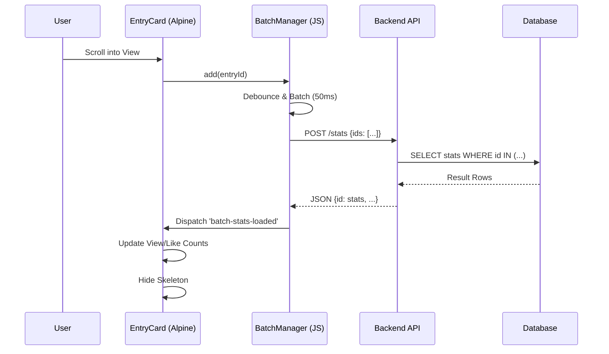

# 日记社交统计信息异步加载全栈优化方案 (Async Social Loading Optimization Plan)

## 0. 执行前准备清单 (Pre-execution Checklist)

### 0.1 环境检查
- [ ] Go 版本 >= 1.25
- [ ] Node.js 版本 >= 18
- [ ] 数据库连接正常
- [ ] 测试用户账号已创建

### 0.2 代码分支
- [ ] 从 master 创建新分支 `feature/async-social-loading`
- [ ] 确保本地代码与远程同步

### 0.3 依赖检查
- [ ] `go mod tidy` 已执行
- [ ] `npm install` 已执行
- [ ] 所有依赖版本符合要求

---

## 1. 现状分析 (Status Analysis)

### 1.1 相关页面

- **最新公开日记页面**: `/u/:uid/latest`
- **日记本列表页面**: `/diary/:diaryId`
- **日记详情页面**: 通过 uno box 打开 `/entry/:entryId`

### 1.2 问题总结

1. **列表页面**: 服务端渲染时已经传递了统计数据，但前端又通过API批量加载，存在重复请求。
2. **uno box查看详情**: 在box中查看日记时，不需要加载列表中其他日记的统计信息，但当前实现会触发 `loadStats()` 加载所有。
3. **数据一致性**: 后端渲染的统计数据可能不是最新的。
4. **状态同步缺失**: 在日记本列表页面，修改日记本社交开关（on/off）时，日记卡片的统计信息区域没有实时更新（增加或移除）。
5. **上下文丢失**: 在日记本列表页面修改日记保存后，日记卡片的操作菜单中"编辑"选项消失（仅剩删除），提示可能存在上下文（CurrentUserID）丢失或DOM更新异常。

### 1.3 当前实现现状 (Current Implementation Status)

#### 1.3.1 已实现功能

**文件位置**: `website/static/src/js/modules/social.js`

**现有实现**:
- `SocialMixin`: 基础 stats 对象管理，使用 Map 存储 entryId -> stats
- `getStats(entryId)`: 从 stats Map 获取数据的方法
- `loadStats()`: 批量加载统计信息（当前存在问题：会加载所有卡片）
- `toggleLike(entryId)`: 点赞功能实现
- `loadDiaryLike()`: 加载日记本点赞状态

**模板状态**: `website/views/diary/entry_card.html`
- 已使用 Alpine.js `x-data` 绑定状态
- 已使用 `x-effect` 初始化 stats 数据
- 显示服务端渲染的统计数据

#### 1.3.2 需要替换的代码

**文件**: `website/static/src/js/modules/social.js`

**需要删除/替换**:
- `SocialMixin` 中的 `loadStats()` 方法（会被 `BatchStatsManager` 替代）
- 模板中的 `x-effect` 初始化逻辑（会被 `entryStats` 组件替代）

**需要保留**:
- `toggleLike(entryId)` 方法
- `getStats(entryId)` 方法（或重构到 `entryStats` 组件内部）
- `loadDiaryLike()` 方法

**需要新增**:
- `BatchStatsManager`: 批量加载管理器（去重、防抖）
- `entryStats(entryId)` 函数: Alpine.js 组件（懒加载、事件监听）
- `getBatchStatsManager()` 函数: 导出管理器供其他模块使用
- 全局事件常量定义

---

## 2. 异步加载优化方案 (Async Social Loading Solution)

### 2.1 核心设计原则

1. **DOM占位符**: 列表页面不渲染实际的统计数据，只渲染占位符。
2. **按需加载**: 只加载可见区域或用户交互相关的统计信息。
3. **独立加载**: uno box中的日记详情独立加载，不影响列表页面。
4. **懒加载**: 列表页面使用懒加载，只加载进入视口的卡片统计信息。
5. **状态同步**: 通过全局事件实现跨组件状态同步。
6. **动态边界处理**: 处理日记本社交开关变化（on/off）时的UI和数据同步。

### 2.2 体验与性能优化 (Optimization)

为了进一步提升用户体验并遵循业界最佳实践，在上述方案基础上增加以下优化措施：

1.  **Optimistic UI (乐观更新)**:
    - 针对点赞 (`Like`) 操作，采用乐观 UI 更新策略。
    - 用户点击瞬间立即反转点赞状态并更新计数，无需等待 API 响应。
    - 若 API 请求失败，则静默回滚状态，并可选提示用户。
    - **收益**: 消除网络延迟感，操作响应如本地应用般丝滑。

2.  **Lazy Loading (懒加载)**:
    - 使用 `IntersectionObserver` 监听卡片是否进入视口。
    - 设置 `rootMargin: '100px'` 提前触发加载，减少用户感知的加载时间。
    - 触发加载后立即 `unobserve`，避免重复触发。
    - 使用 `loadedEntryIds` 和 `pendingEntryIds` Set 进行去重，确保每个 entryId 只加载一次。
    - **收益**: 只加载用户可见或即将可见的卡片统计信息，减少 API 请求量。

3.  **Layout Stability (CLS 预防)**:
    - 确保 `EntryStats` 的占位符/骨架屏 (`skeleton`) 高度与最终加载的内容高度严格一致。
    - 使用 `min-height` 或固定高度容器，防止数据加载完成后导致页面布局跳动 (Cumulative Layout Shift)。
    - **收益**: 提升视觉稳定性，符合 Google Core Web Vitals 标准。

---

## 3. 总体架构设计 (Overall Architecture Design)

### 3.1 技术栈基础设施 (Tech Stack)

- **Backend**: Go 1.25, Gin Framework.
- **Frontend**: Alpine.js v3.x, Tailwind CSS v4, HTMX ^2.0.
- **Database**: PostgreSQL.
- **Testing**: Go `testing` package (Backend), Jest (Frontend).

### 3.2 分层架构与交互规范 (Layered Architecture)

本方案遵循 DDD (领域驱动设计) 分层架构，确保职责分离。

| 分层 (Layer)                  | 模块 (Module)                          | 职责 (Responsibility)                    | 交互规范 (Interaction)                                    |
| :---------------------------- | :------------------------------------- | :--------------------------------------- | :-------------------------------------------------------- |
| **表现层 (Presentation)**     | `website/views/**`, `entry_card.html`  | 负责 UI 渲染、骨架屏展示、用户交互捕获。 | 使用 `x-data` 绑定状态，通过 `CustomEvent` 与业务层通信。 |
| **客户端业务层 (Client Biz)** | `social.js` (BatchManager, EntryStats) | 负责防抖、缓存管理、懒加载、乐观更新逻辑。 | 调用后端 JSON API，分发全局事件更新 UI。                  |
| **服务端业务层 (Server Biz)** | `internal/app/controller/entry`        | 负责请求校验、聚合数据、权限检查。       | 接收 JSON 请求，返回标准化 `APIResponse`。                |
| **数据层 (Data Access)**      | `internal/infra/repository/entry`      | 负责高效 SQL 查询 (JOIN优化)。           | 执行 SQL，返回 Domain Model。                             |

### 3.3 编码与命名规范 (Standards)

- **Go**: 遵循 `Uber Go Style Guide`。接口名 `Interface` 后缀 (如 `StatsProvider`), 实现名无后缀。
- **JS**: 驼峰命名 (`batchStatsManager`)。常量全大写 (`BATCH_SIZE`)。
- **目录**:
  - JS 模块: `website/static/src/js/modules/social.js`
  - Go 控制器: `internal/app/controller/entry/stats_controller.go`

### 3.4 数据结构定义 (Data Structures)

#### 3.4.1 前端数据结构

```javascript
/**
 * @typedef {Object} EntryStatsData
 * @property {number} view_num - 浏览量
 * @property {number} comment_num - 评论数
 * @property {number} like_num - 点赞数
 * @property {boolean} liked - 当前用户是否已点赞
 * @property {boolean} loaded - 是否已加载
 * @property {boolean} loading - 是否正在加载
 */

/**
 * @typedef {Object} BatchStatsManagerState
 * @property {Set<string>} pendingEntryIds - 待加载的 entryId 集合
 * @property {Set<string>} loadedEntryIds - 已加载的 entryId 集合
 * @property {number|null} timer - 防抖定时器
 * @property {boolean} loading - 是否正在加载
 */
```

#### 3.4.2 后端数据结构

```go
type EntryStatsResponse struct {
    EntryID    int64  `json:"entry_id"`
    ViewNum    int64  `json:"view_num"`
    CommentNum int64  `json:"comment_num"`
    LikeNum    int64  `json:"like_num"`
}

type LikeStatusResponse struct {
    EntryID int64  `json:"entry_id"`
    Liked   bool   `json:"liked"`
}
```

#### 3.4.3 自定义事件定义

```javascript
// 全局事件名称常量
const EVENTS = {
    BATCH_STATS_LOADED: 'batch-stats-loaded',
    BATCH_LIKE_STATUS_LOADED: 'batch-like-status-loaded',
    ENTRY_LIKED: 'entry-liked',
    ENTRY_COMMENT_UPDATED: 'entry-comment-updated',
};
```

### 3.5 文件修改清单和依赖关系 (File Modification List)

#### 必须按顺序修改的文件（有依赖关系）

1. **`website/static/src/js/modules/social.js`**
   - **新增**: BatchStatsManager 对象（去重、防抖、批量加载）
   - **新增**: entryStats(entryId) Alpine.js 组件函数
   - **新增**: getBatchStatsManager() 导出函数
   - **修改**: 删除/重构 SocialMixin 中的 loadStats() 方法
   - **新增**: 全局事件常量定义
   - **依赖**: 无

2. **`website/views/diary/entry_card.html`**
   - **修改**: 社交统计区域模板，使用 x-data="entryStats()" 和 x-init="initStats()"
   - **修改**: 添加加载状态占位符
   - **依赖**: 步骤1完成

3. **`website/static/src/js/core/init.js`**
   - **新增**: 导入 getBatchStatsManager 和 entryStats
   - **新增**: 注册 Alpine.data('entryStats', entryStats)
   - **新增**: 导出 window.batchStatsManager
   - **依赖**: 步骤1完成

4. **`website/views/entry/detail.html`**
   - **修改**: box 详情页使用 entryStats 组件
   - **新增**: 编辑按钮（需要 CurrentUserID）
   - **依赖**: 步骤1、3完成

5. **`website/static/src/js/modules/diary-detail.js`**
   - **修改**: _updateDiaryUI() 方法处理 social_setting 变化
   - **新增**: 社交开关切换时清理/重新加载统计信息
   - **新增**: 导入 getBatchStatsManager
   - **依赖**: 步骤1完成

6. **`internal/app/controller/entry/view.go`**
   - **修改**: ShowEntry() 方法添加 CurrentUserID 到返回数据
   - **依赖**: 无

7. **`internal/app/controller/entry/handlers.go`**
   - **修改**: UpdateEntry() 方法处理 source=box 时的 entryUpdated 事件
   - **依赖**: 无

#### 可以并行修改的文件
- 测试文件可以并行编写

### 3.6 核心实现逻辑 (Core Implementation Logic)

#### 3.6.1 BatchStatsManager 核心算法

```javascript
const batchStatsManager = {
  pendingEntryIds: new Set(),
  loadedEntryIds: new Set(),
  timer: null,
  loading: false,

  // 添加待加载的 entryId
  addEntryId(entryId) {
    const idStr = String(entryId);

    // 1. 去重检查
    if (this.loadedEntryIds.has(idStr) || this.pendingEntryIds.has(idStr)) {
      return;
    }

    // 2. 添加到待加载队列
    this.pendingEntryIds.add(idStr);

    // 3. 防抖处理（100ms）
    if (this.timer) clearTimeout(this.timer);
    this.timer = setTimeout(() => this.loadBatchStats(), 100);
  },

  // 批量加载统计信息
  async loadBatchStats() {
    // 1. 状态检查
    if (this.loading || this.pendingEntryIds.size === 0) return;

    // 2. 锁定状态
    this.loading = true;
    const entryIds = Array.from(this.pendingEntryIds);
    this.pendingEntryIds.clear();

    try {
      // 3. 并行请求（stats + like status）
      const [statsResponse, likeResponse] = await Promise.all([
        fetch('/api/entry/stats', {
          method: 'POST',
          headers: { 'Content-Type': 'application/json' },
          body: JSON.stringify({ entryids: entryIds.join(',') })
        }),
        fetch('/api/entry/like/status', {
          method: 'POST',
          headers: { 'Content-Type': 'application/json' },
          body: JSON.stringify({ entryids: entryIds.join(',') })
        })
      ]);

      // 4. 处理响应并构建 Map
      const statsMap = {};
      const statsResult = await safeJson(statsResponse);
      if (statsResult?.success && statsResult.data?.stats) {
        statsResult.data.stats.forEach(stat => {
          statsMap[stat.entry_id] = {
            view_num: stat.view_num || 0,
            comment_num: stat.comment_num || 0,
            like_num: stat.like_num || 0
          };
        });
      }

      const statusMap = {};
      const likeResult = await safeJson(likeResponse);
      if (likeResult?.success && likeResult.data?.status) {
        likeResult.data.status.forEach(status => {
          statusMap[status.entry_id] = status.liked;
        });
      }

      // 5. 派发全局事件
      window.dispatchEvent(new CustomEvent('batch-stats-loaded', {
        detail: { stats: statsMap }
      }));

      window.dispatchEvent(new CustomEvent('batch-like-status-loaded', {
        detail: { statuses: statusMap }
      }));

      // 6. 记录已加载
      entryIds.forEach(id => this.loadedEntryIds.add(String(id)));

    } catch (error) {
      console.error('批量加载失败:', error);
    } finally {
      // 7. 解锁状态
      this.loading = false;
    }
  },

  // 清理状态（用于社交功能切换）
  clear() {
    this.pendingEntryIds.clear();
    this.loadedEntryIds.clear();
    if (this.timer) {
      clearTimeout(this.timer);
      this.timer = null;
    }
  }
};
```

#### 3.6.2 EntryStats 组件核心逻辑

```javascript
export function entryStats(entryId) {
  return {
    entryId: entryId,
    stats: {
      loaded: false,
      loading: false,
      view_num: 0,
      comment_num: 0,
      like_num: 0,
      liked: false
    },
    observer: null,

    async initStats() {
      // 1. 判断环境（box vs 列表）
      const isInBox = this.$el.closest('.uno-box') !== null ||
                      this.$root.closest('.uno-box') !== null;

      if (isInBox) {
        await this.loadSingleStats();
      } else {
        await this.loadWhenVisible();
      }

      // 2. 绑定全局事件
      this._bindGlobalEvents();
    },

    async loadWhenVisible() {
      // 1. 状态检查
      if (this.stats.loaded || this.stats.loading) return;

      // 2. 创建 IntersectionObserver
      this.observer = new IntersectionObserver((entries) => {
        entries.forEach(entry => {
          if (entry.isIntersecting && !this.stats.loaded) {
            // 3. 添加到批量管理器
            batchStatsManager.addEntryId(this.entryId);
            this.stats.loading = true;
            this.observer?.unobserve(entry.target);
          }
        });
      }, { rootMargin: '100px' });

      // 4. 开始观察
      const el = this.$el;
      if (el) {
        this.observer.observe(el);
      }
    },

    async loadSingleStats() {
      if (this.stats.loading || this.stats.loaded) return;
      this.stats.loading = true;

      try {
        const [statsResponse, likeResponse] = await Promise.all([
          fetch('/api/entry/stats', {
            method: 'POST',
            headers: { 'Content-Type': 'application/json' },
            body: JSON.stringify({ entryids: String(this.entryId) })
          }),
          fetch('/api/entry/like/status', {
            method: 'POST',
            headers: { 'Content-Type': 'application/json' },
            body: JSON.stringify({ entryids: String(this.entryId) })
          })
        ]);

        // 处理响应
        const statsResult = await safeJson(statsResponse);
        if (statsResult?.success && statsResult.data?.stats?.[0]) {
          const stat = statsResult.data.stats[0];
          this.stats.view_num = stat.view_num || 0;
          this.stats.comment_num = stat.comment_num || 0;
          this.stats.like_num = stat.like_num || 0;
        }

        const likeResult = await safeJson(likeResponse);
        if (likeResult?.success && likeResult.data?.status?.[0]) {
          const status = likeResult.data.status[0];
          this.stats.liked = status.liked;
        }

        this.stats.loaded = true;
      } catch (error) {
        console.error('加载统计信息失败:', error);
        this.stats.loaded = true;
      } finally {
        this.stats.loading = false;
      }
    },

    async toggleLike() {
      if (this.stats.loading) return;

      // 乐观更新
      const oldLiked = this.stats.liked;
      const oldCount = this.stats.like_num;
      this.stats.liked = !oldLiked;
      this.stats.like_num = oldLiked ? oldCount - 1 : oldCount + 1;

      try {
        const response = await fetch('/api/entry/like', {
          method: 'POST',
          headers: { 'Content-Type': 'application/json' },
          body: JSON.stringify({ entry_id: parseInt(this.entryId) })
        });

        const result = await response.json();
        if (result.success && result.data) {
          this.stats.liked = result.data.is_liked;
          this.stats.like_num = result.data.like_count;
        } else {
          // 回滚
          this.stats.liked = oldLiked;
          this.stats.like_num = oldCount;
        }
      } catch (error) {
        // 回滚
        this.stats.liked = oldLiked;
        this.stats.like_num = oldCount;
      }
    },

    _bindGlobalEvents() {
      this._onBatchStatsLoaded = (evt) => {
        const { stats } = evt.detail;
        if (stats[this.entryId]) {
          const data = stats[this.entryId];
          this.stats.view_num = data.view_num;
          this.stats.comment_num = data.comment_num;
          this.stats.like_num = data.like_num;
          this.stats.loaded = true;
          this.stats.loading = false;
        }
      };

      this._onBatchLikeStatusLoaded = (evt) => {
        const { statuses } = evt.detail;
        if (statuses[this.entryId] !== undefined) {
          this.stats.liked = statuses[this.entryId];
        }
      };

      this._onEntryLiked = (evt) => {
        const { entryId, liked, count } = evt.detail;
        if (parseInt(this.entryId) === entryId) {
          this.stats.liked = liked;
          this.stats.like_num = count;
        }
      };

      window.addEventListener('batch-stats-loaded', this._onBatchStatsLoaded);
      window.addEventListener('batch-like-status-loaded', this._onBatchLikeStatusLoaded);
      window.addEventListener('entry-liked', this._onEntryLiked);
    },

    destroy() {
      this.observer?.disconnect();
      window.removeEventListener('batch-stats-loaded', this._onBatchStatsLoaded);
      window.removeEventListener('batch-like-status-loaded', this._onBatchLikeStatusLoaded);
      window.removeEventListener('entry-liked', this._onEntryLiked);
    }
  };
}
```

### 3.7 边界情况处理 (Edge Cases)

#### 3.7.1 社交功能开关切换

**检测方式**:
在 `diary-detail.js` 的 `_updateDiaryUI()` 方法中比较新旧 `social_setting` 值

**处理逻辑**:
```javascript
if (this.socialSetting !== diary.social_setting) {
  if (diary.social_setting === 0) {
    // 关闭社交：清理状态
    const batchStatsManager = getBatchStatsManager();
    if (batchStatsManager) {
      batchStatsManager.clear();
    }
    // 重置所有 entryStats 组件
    document.querySelectorAll('[x-data*="entryStats"]').forEach(el => {
      const component = el.__x;
      if (component?.stats) {
        component.stats.loaded = false;
        component.stats.loading = false;
      }
    });
  } else {
    // 开启社交：重新初始化
    document.querySelectorAll('[x-data*="entryStats"]').forEach(el => {
      const component = el.__x;
      component?.initStats?.();
    });
  }
}
```

#### 3.7.2 编辑后上下文丢失

**问题**: HTMX 替换 DOM 后，CurrentUserID 丢失

**解决方案**:
- **后端**: 在 `handlers.go` 的 `UpdateEntry` 方法中确保返回 `CurrentUserID`
- **模板**: 在 `entry_card.html` 中通过 `{{.CurrentUserID}}` 渲染
- **HTMX**: 使用 `hx-swap="outerHTML"` 确保完整替换

#### 3.7.3 box 中查看日记

**判断逻辑**:
```javascript
const isInBox = this.$el.closest('.uno-box') !== null ||
                this.$root.closest('.uno-box') !== null;
```

**加载策略**:
- box 中: 立即加载单个 (`loadSingleStats`)
- 列表中: 懒加载 (`loadWhenVisible`)

#### 3.7.4 重复加载问题

**解决方案**:
- 使用 `loadedEntryIds` Set 记录已加载的 entryId
- 在 `addEntryId` 中检查，已加载或待加载的不重复添加
- 在 `IntersectionObserver` 触发后立即 `unobserve`，避免重复触发

#### 3.7.5 Alpine.js x-init 不触发

**问题**: 使用 `htmx:afterSwap` 事件时，initTree() 可能未执行

**解决**: 确保在 `init.js` 中有监听 `htmx:afterSwap` 并调用 `Alpine.initTree(target)`

### 3.8 修改前后对比 (Before/After Comparison)

#### 修改前 - social.js (SocialMixin)

```javascript
export function SocialMixin() {
  return {
    stats: {}, // 服务端渲染后存储

    getStats(entryId) {
      return this.stats[entryId] || { view_num: 0, comment_num: 0, like_num: 0 };
    },

    loadStats() {
      // 当前实现：直接加载所有统计（有问题）
      fetch('/api/entry/stats')
        .then(r => r.json())
        .then(data => {
          this.stats = data;
        });
    },

    toggleLike(entryId) {
      // 保留不变
    }
  };
}
```

#### 修改后 - social.js

```javascript
// 新增：批量管理器
const batchStatsManager = {
  pendingEntryIds: new Set(),
  loadedEntryIds: new Set(),
  timer: null,
  loading: false,

  addEntryId(entryId) { /* ... */ },
  loadBatchStats() { /* ... */ },
  clear() { /* ... */ }
};

// 新增：独立组件
export function entryStats(entryId) {
  return {
    entryId: entryId,
    stats: { loaded: false, loading: false, /* ... */ },
    initStats() { /* 懒加载逻辑 */ },
    toggleLike() { /* 乐观更新 */ }
  };
}

// 新增：导出函数
export function getBatchStatsManager() {
  return batchStatsManager;
}

// 保留：点赞等方法
export function SocialMixin() {
  return {
    toggleLike(entryId) { /* 保持不变 */ }
  };
}
```

#### 修改前 - entry_card.html

```html
<div x-effect="stats[{{.Entry.EntryID}}] = { view_num: {{.Entry.ViewNum}}, ... }">
  <span x-text="getStats({{.Entry.EntryID}}).view_num"></span>
</div>
```

#### 修改后 - entry_card.html

```html
<div x-data="entryStats({{.Entry.EntryID}})" x-init="initStats()">
  <span x-show="stats.loaded" x-text="stats.view_num">-</span>
  <span x-show="!stats.loaded" class="animate-pulse">-</span>
</div>
```

### 3.9 常见错误和解决方案 (Common Errors)

#### 错误1: Alpine.js x-init 不触发

**原因**: 使用 `htmx:afterSwap` 事件时，initTree() 可能未执行

**解决**:
```javascript
// 确保在 init.js 中
document.body.addEventListener('htmx:afterSwap', (evt) => {
  const target = evt?.detail?.target;
  if (target) {
    window.Alpine.initTree(target);
  }
});
```

#### 错误2: batchStatsManager 为 undefined

**原因**: 模块导出问题或打包时被 tree-shaking 移除

**解决**:
```javascript
// 方式1: 在 init.js 中导出
window.batchStatsManager = getBatchStatsManager();

// 方式2: 使用 Object.defineProperty（更可靠）
Object.defineProperty(window, 'batchStatsManager', {
  value: batchStatsManager,
  writable: false,
  configurable: false,
  enumerable: true
});
```

#### 错误3: 编辑按钮消失

**原因**: HTMX 替换 DOM 时，CurrentUserID 丢失

**解决**: 确保后端返回数据包含 `CurrentUserID`，模板中正确渲染

#### 错误4: 统计信息不加载

**原因**: IntersectionObserver 未触发或选择器错误

**解决**:
```javascript
// 检查元素是否正确
const el = this.$el;
if (!el) {
  console.error('element not found');
  return;
}

// 调试 observer
console.log('observing:', el);
this.observer.observe(el);
```

#### 错误5: 重复加载

**原因**: loadedEntryIds 未正确维护或检查逻辑有误

**解决**: 确保 `addEntryId` 中的去重检查正确，并且 `loadBatchStats` 后正确更新 `loadedEntryIds`

#### 错误6: 点赞回滚失败

**原因**: API 错误处理不完整

**解决**: 确保 toggleLike 中的 try-catch 正确捕获错误并执行回滚

---

## 4. 分阶段交付计划 (Phased Delivery Plan)

### 阶段 1: 核心模块骨架搭建 (Skeleton & Contracts)

**目标**: 确立接口契约，完成数据库查询优化，定义配置结构。

#### 任务清单
- [ ] **1.1 接口契约定义**:
  - [ ] 定义前端 `EntryStatsData` 和 `SocialConfig` JSDoc 类型
  - [ ] 定义后端 `EntryStatsResponse` Go Struct
  - [ ] 定义全局事件常量

- [ ] **1.2 数据库查询优化**:
  - [ ] **Input**: `diary_id`
  - [ ] **Process**: 修改 `EntryRepository.ListByDiaryID`，添加 `LEFT JOIN br_diary`
  - [ ] **Output**: 包含 `DiaryTitle` 的 Entry 列表

- [ ] **1.3 基础配置注入**:
  - [ ] 在 `list.html` / `detail.html` 中注入全局 `window.SocialConfig` 对象

#### 验证检查点
- [ ] JSDoc 类型定义已添加到 social.js
- [ ] Go Struct 定义已添加到相应的控制器文件
- [ ] 数据库查询优化已测试通过
- [ ] 浏览器控制台 `window.SocialConfig` 可访问

---

### 阶段 2: 业务逻辑实现 (Business Logic Implementation)

**目标**: 完成前端批量加载器、Alpine 组件及后端 API 改造。

#### 任务清单
- [ ] **2.1 BatchStatsManager (JS)**:
  - [ ] **Input**: `add(entryId)` 调用流
  - [ ] **Process**: 去重 (Set) -> 防抖 (100ms) -> API 请求
  - [ ] **Output**: 分发 `batch-stats-loaded` 事件
  - [ ] 实现 `clear()` 方法

- [ ] **2.2 EntryStats Component (Alpine)**:
  - [ ] **Input**: `x-data` 初始化参数
  - [ ] **Process**: `IntersectionObserver` 监听 -> 触发加载 -> 渲染数据/骨架屏
  - [ ] **Output**: 动态 DOM 更新
  - [ ] 实现 `loadSingleStats()` 和 `loadWhenVisible()`
  - [ ] 实现乐观更新 `toggleLike()`

- [ ] **2.3 后端 API 改造**:
  - [ ] **Input**: `POST /api/entry/stats` `{ids: [...]}`
  - [ ] **Process**: 并发获取 Stats 和 Like Status -> 组装 Map
  - [ ] **Output**: JSON Response

#### 验证检查点
- [ ] `batchStatsManager` 对象存在且方法完整
- [ ] `entryStats` 组件正常工作
- [ ] 列表页面显示占位符
- [ ] 滚动页面时触发批量加载
- [ ] API 返回正确的 JSON 格式

---

### 阶段 3: 集成与性能调优 (Integration & Optimization)

**目标**: 处理边界情况，全局状态同步，性能达标。

#### 任务清单
- [ ] **3.1 全局状态同步**:
  - [ ] 实现 `social-setting-changed` 事件
  - [ ] 联动列表页与设置页
  - [ ] 实现 `handleEntryUpdateSuccess`

- [ ] **3.2 边界情况处理**:
  - [ ] 社交功能开关切换
  - [ ] 编辑后上下文保持
  - [ ] box 中查看日记
  - [ ] 重复加载预防

- [ ] **3.3 性能调优**:
  - [ ] 调整 `IntersectionObserver` 的 `rootMargin` (默认 100px)
  - [ ] 验证 `CLS` (Cumulative Layout Shift) 为 0
  - [ ] 测试快速滚动场景

#### 验证检查点
- [ ] 切换社交功能开关，统计信息正确显示/隐藏
- [ ] box 中查看日记，统计信息立即加载
- [ ] box 中上下篇导航，统计信息重新加载
- [ ] 点赞操作有乐观更新效果
- [ ] 编辑后上下文保持正常
- [ ] CLS 指标为 0

---

## 5. 单元测试与覆盖率要求 (Unit Testing & Coverage)

### 5.1 测试策略

- **Backend (Go)**: 使用标准 `testing` 包。
  - **Repository**: 使用 `testcontainers` 或 Mock DB 验证 SQL。
  - **Controller**: 使用 `httptest` 验证 API 响应格式。
- **Frontend (JS)**: 使用 `Jest` (或模拟环境)。
  - **BatchManager**: Mock `fetch`，验证防抖和去重逻辑。
  - **EntryStats**: 验证组件状态转换和事件监听。

### 5.2 覆盖率标准

- **行覆盖率 (Line Coverage)**: ≥ 90%
- **分支覆盖率 (Branch Coverage)**: ≥ 85%
- **集成测试 (Integration)**: 核心路径 (加载->展示->点赞) 100% 通过。

### 5.3 测试用例清单 (示例)

| 模块                | 测试场景 | 输入             | 预期输出                          | 类型  |
| :------------------ | :------- | :--------------- | :-------------------------------- | :---- |
| `BatchStatsManager` | 正常批量 | Add 100 IDs      | Fetch called with all IDs         | Unit  |
| `BatchStatsManager` | 重复添加 | Add ID "1" twice | Pending queue size = 1            | Unit  |
| `BatchStatsManager` | 清理状态 | clear()          | pending & loaded 均为空          | Unit  |
| `EntryStats`        | 乐观点赞 | Click Like       | `liked`=true, `num`+1 immediately | Unit  |
| `EntryStats`        | 懒加载   | Scroll into view | addEntryId called once            | Unit  |
| `EntryStats`        | 社交开关关闭 | SocialSetting=0 | stats.loaded=false, loading=false | Unit  |
| `EntryStats`        | 社交开关开启 | SocialSetting=1 | initStats() called                | Unit  |
| `API`               | 空列表   | `ids: []`        | `200 OK`, `data: {}`              | Integ |
| `API`               | 批量请求 | 100 IDs         | P99 ≤ 200ms                       | Perf  |

---

## 6. 规则与约束清单 (Rules & Constraints)

### 6.1 事务边界 (Transaction)

- **点赞操作**: 涉及 `br_entry_stat` 更新和 `br_entry_like` 插入，必须在数据库事务中执行。
- **读取操作**: 统计信息读取允许脏读 (Read Committed)，无需显式事务。

### 6.2 幂等性 (Idempotency)

- **点赞接口**: `POST /api/entry/like` 必须处理重复调用。若已点赞再次请求，应返回"已点赞"状态或执行取消 (Toggle)，明确语义。推荐使用 `action=like|unlike` 参数明确意图。

### 6.3 数据一致性 (Consistency)

- **最终一致性**: 列表页统计数据允许有秒级延迟。
- **补偿机制**: 前端乐观更新失败时，必须触发 `rollback` 回滚 UI 状态，并显示错误 Toast。

---

## 7. 上下文一致性保障 (Context Consistency)

### 7.1 全链路追踪

- **TraceID**: 所有 API 请求 Header 需携带 `X-Request-ID`。
- **Go Context**: `gin.Context` 必须透传至 Service 和 Repository 层。

### 7.2 日志规范

- 使用结构化日志 `slog`。
- **必填字段**: `request_id`, `user_id`, `client_ip`, `module`.
- **示例**:
  ```go
  slog.Info("Batch stats loaded",
      "request_id", ctx.GetString("request_id"),
      "count", len(ids),
      "duration_ms", 15)
  ```

### 7.3 异常拦截

- 前端 `fetch` 拦截器：检测 `401 Unauthorized` 自动跳转登录。
- 后端中间件：Panic Recovery 必须捕获并记录堆栈，返回标准化错误 JSON。

---

## 8. 设计文档丰富度 (Design Details)

### 8.1 时序图 (Sequence Diagram)



### 8.2 接口清单 (API List)

| Method | Path               | Request Body         | Response                            | Description  |
| :----- | :----------------- | :------------------- | :---------------------------------- | :----------- |
| `POST` | `/api/entry/stats` | `{ids: [1, 2, ...]}` | `{success: true, data: {1: {...}}}` | 批量获取统计 |
| `POST` | `/api/entry/like/status` | `{ids: [1, 2, ...]}` | `{success: true, data: {1: {...}}}` | 批量获取点赞状态 |
| `POST` | `/api/entry/like`  | `{id: 1}`            | `{success: true, liked: true}`      | 切换点赞状态 |

### 8.3 第三方库版本锁定

- **Go**: `go.mod`
  ```
  go 1.25
  require (
      github.com/gin-gonic/gin v1.9.1
      github.com/jackc/pgx/v5 v5.5.0
  )
  ```
- **JS**: `package.json`
  ```json
  {
    "dependencies": {
      "alpinejs": "^3.13.0",
      "htmx.org": "^1.9.10"
    }
  }
  ```

### 8.4 环境差异矩阵

| 配置项       | Dev               | Staging | Prod |
| :----------- | :---------------- | :------ | :--- |
| `DebounceMs` | 500 (方便观察)    | 100     | 100  |
| `LogLevel`   | Debug             | Info    | Warn |

---

## 9. 成功标准与验收条件 (Success Criteria)

### 9.1 自动化验收

- **CI Pipeline**: Lint Pass, Unit Test Pass (100%), Build Success.
- **Security**: No High/Critical vulnerabilities in dependencies.

### 9.2 性能基准

- **API Latency**: `/stats` P99 ≤ 200ms (50 IDs batch).
- **Frontend**: TTI (Time to Interactive) 无显著增加。
- **CLS**: 0 (骨架屏高度严格匹配真实内容)。

### 9.3 错误率

- API 错误率 ≤ 0.1%。

---

## 10. 交付物清单 (Deliverables)

### 10.1 源码
- `website/static/src/js/modules/social.js` (完整实现)
- `website/views/diary/entry_card.html` (修改后模板)
- `website/views/entry/detail.html` (box 详情页)
- `website/static/src/js/core/init.js` (组件注册)
- `website/static/src/js/modules/diary-detail.js` (状态同步)
- `internal/app/controller/entry/view.go` (CurrentUserID)
- `internal/app/controller/entry/handlers.go` (entryUpdated 事件)
- `internal/infra/repository/entry/entry.go` (SQL 优化)

### 10.2 测试报告
- Go Test Coverage Report (`coverage.html`)
- JS Test Results

### 10.3 文档
- 更新后的 `README.md` (包含配置说明)
- 本设计文档 (`async_social_loading_design.md`)