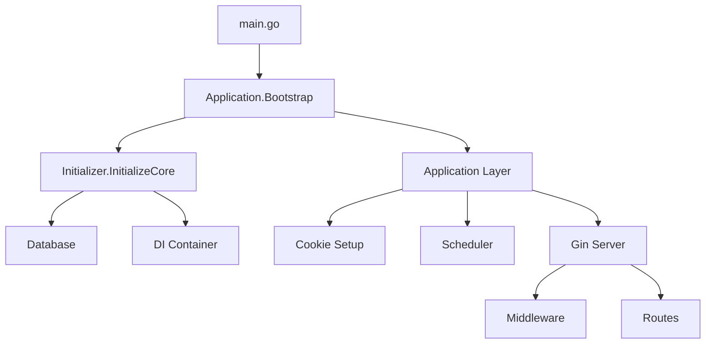
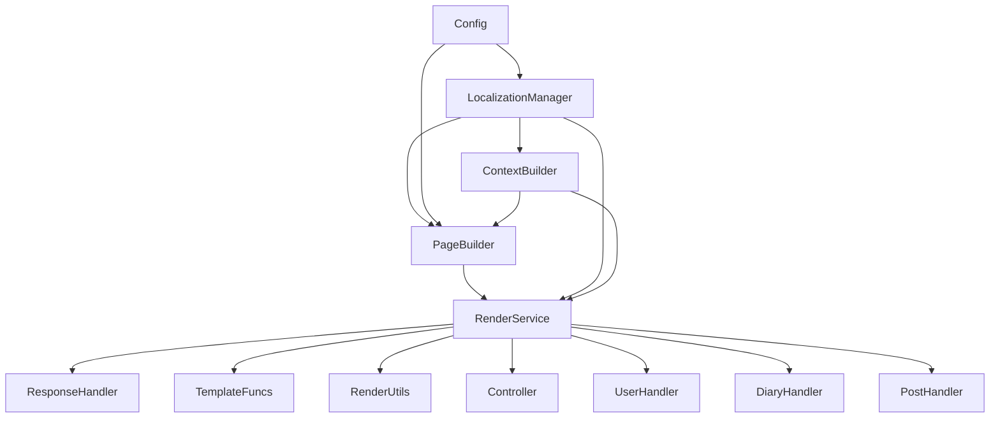

# 依赖注入容器使用指南

## 概述

iDiary采用分层架构的依赖注入（DI）系统，核心基础设施由`internal/core/bootstrap/Initializer`管理，应用层组件由`internal/app/bootstrap/Application`管理。该DI容器基于Go泛型实现高性能的服务解析，支持单例和工厂模式。

## 架构设计

### 1. 双层初始化架构



### 2. 容器接口设计

```go
// 核心DI容器接口
type ContainerInterface interface {
    // 注册单例服务
    RegisterSingleton[T any](factory func(ContainerInterface) (T, error)) error
    
    // 注册瞬态服务
    RegisterTransient[T any](factory func(ContainerInterface) (T, error)) error
    
    // 解析服务实例
    Resolve[T any]() (T, error)
}
```

## 实际启动流程

### 1. 主程序入口

**文件**: `cmd/idiary/main.go`

```go
func main() {
    // 1. 初始化配置和日志（在main.go中完成）
    config.InitConfig()
    
    // 2. 创建应用实例
    app := bootstrap.NewApplication()
    
    // 3. 启动应用
    if err := app.Bootstrap(); err != nil {
        slog.Error("应用启动失败", "error", err)
        os.Exit(1)
    }
    
    // 4. 运行服务器
    app.Run()
}
```

### 2. 核心基础设施初始化

**文件**: `internal/core/bootstrap/initializer.go`

```go
func (i *Initializer) InitializeCore() error {
    // 1. 获取已初始化的配置
    i.config = config.GetConfig()
    if i.config == nil {
        return fmt.Errorf("配置未初始化")
    }

    // 2. 初始化数据库
    if err := i.initDatabase(); err != nil {
        return fmt.Errorf("数据库初始化失败: %w", err)
    }

    // 3. 初始化DI容器
    if err := i.initContainer(); err != nil {
        return fmt.Errorf("DI容器初始化失败: %w", err)
    }

    return nil
}

func (i *Initializer) initContainer() error {
    i.container = di.NewContainer()

    // 注册App层服务
    if err := di.RegisterAppServices(i.container); err != nil {
        return fmt.Errorf("注册App层服务失败: %w", err)
    }

    slog.Info("成功注册DI服务")
    return nil
}
```

### 3. 应用层初始化

**文件**: `internal/app/bootstrap/application.go`

```go
func (a *Application) Bootstrap() error {
    // 1. 初始化核心基础设施
    if err := a.coreInit.InitializeCore(); err != nil {
        return fmt.Errorf("核心初始化失败: %w", err)
    }

    // 2. 获取核心组件
    a.config = a.coreInit.GetConfig()
    a.container = a.coreInit.GetContainer()

    // 3. 初始化应用层组件
    if err := a.initApplicationLayer(); err != nil {
        return fmt.Errorf("应用层初始化失败: %w", err)
    }

    return nil
}

func (a *Application) initApplicationLayer() error {
    // 1. 设置 Cookie 默认值
    if err := a.initCookie(); err != nil {
        return err
    }

    // 2. 启动定时任务
    if err := a.initScheduler(); err != nil {
        return err
    }

    // 3. 初始化 Gin 服务器
    if err := a.initGinServer(); err != nil {
        return err
    }

    return nil
}
```

## 服务注册机制

### 1. 核心服务注册

**文件**: `internal/core/di/providers.go`

```go
// RegisterAppServices 注册App层服务
func RegisterAppServices(container ContainerInterface) error {
    // 注册RenderService（合并了原来的ViewService和ResponseService）
    err := RegisterSingleton[render.RenderServiceInterface](container, func(c ContainerInterface) (render.RenderServiceInterface, error) {
        cfg := config.GetConfig()
        return render.NewRenderService(cfg), nil
    })
    if err != nil {
        return err
    }

    return nil
}
```

### 2. RenderService内部依赖

**文件**: `internal/app/render/service.go`

```go
func NewRenderService(cfg *config.Config) RenderServiceInterface {
    // 初始化本地化管理器
    localizationManager, err := NewLocalizationManager(cfg)
    if err != nil {
        slog.Error("初始化本地化管理器失败", "error", err)
        // 容错处理：使用空管理器避免系统崩溃
        localizationManager = &LocalizationManager{
            cfg:      cfg,
            messages: make(map[string]map[string]string),
        }
    }

    service := &RenderService{
        config:              cfg,
        contextBuilder:      NewContextBuilder(localizationManager),
        localizationManager: localizationManager,
    }

    // 初始化各个组件
    service.pageBuilder = NewPageBuilder(cfg, service.contextBuilder, service.localizationManager)
    service.responseHandler = NewResponseHandler(service)
    service.templateFuncs = NewTemplateFuncs(service)
    service.utils = NewRenderUtils(service)

    return service
}
```

## 路由层集成

### 1. Gin服务器初始化

**文件**: `internal/app/bootstrap/application.go`

```go
func (a *Application) initGinServer() error {
    // 设置 Gin 模式
    gin.SetMode(a.config.App.GinMode)

    // 初始化默认gin server
    server := gin.New()

    // 初始化中间件
    server.Use(middleware.PanicRecoveryMiddleware())   // panic recovery中间件
    server.Use(middleware.AppErrorHandlerMiddleware()) // 应用错误处理中间件
    server.Use(user.SharedData())                      // 用户共享数据中间件
    slog.Info("成功初始化中间件")

    // 初始化路由
    route.SetWithContainer(server, a.container)
    slog.Info("成功初始化网站静态文件目录及路由")

    a.server = server
    return nil
}
```

### 2. 路由设置

**文件**: `internal/app/route/router.go`

```go
// SetWithContainer 使用DI容器设置路由系统
func SetWithContainer(server *gin.Engine, container di.ContainerInterface) {
    setStaticFs(server, config.GetStaticPath())
    setPath(server, container)
}

func setPath(server *gin.Engine, container di.ContainerInterface) {
    // 通过DI容器创建Controller
    controllerInstance := createController(container)

    // 通过DI容器创建handlers
    userHandler := createUserHandler(container)
    diaryHandler := createDiaryHandler(container)
    postHandler := createPostHandler(container)

    // 基础页面路由
    server.GET("/index", controllerInstance.RenderIndex)

    // 注册模块路由
    userHandler.RegisterRoutes(server)
    diaryHandler.RegisterRoutes(server)
    postHandler.RegisterRoutes(server)
}

func createController(container di.ContainerInterface) *controller.Controller {
    renderService, err := di.Resolve[render.RenderServiceInterface](container)
    if err != nil {
        panic("Failed to resolve RenderService: " + err.Error())
    }

    return controller.NewController(renderService)
}
```

## 渲染系统架构

### 1. 服务依赖关系



### 2. 多语言系统集成

```go
// LocalizationManager 作为核心依赖
type LocalizationManager struct {
    cfg      *config.Config
    messages map[string]map[string]string  // 内存缓存，无需锁
}

// RenderService 集成多语言功能
type RenderService struct {
    config              *config.Config
    contextBuilder      *ContextBuilder      // 依赖LocalizationManager
    pageBuilder         *PageBuilder         // 依赖LocalizationManager
    localizationManager *LocalizationManager // 核心多语言服务
    // ... 其他组件
}
```

## 工厂模式和单例模式

### 1. 单例注册模式

```go
// RegisterSingleton 注册单例服务
func RegisterSingleton[T any](container ContainerInterface, factory func(ContainerInterface) (T, error)) error {
    serviceType := reflect.TypeOf((*T)(nil)).Elem()
    
    provider := newProvider(serviceType, func(c ContainerInterface) (interface{}, error) {
        return factory(c)
    }, true) // singleton = true
    
    return container.registerProvider(serviceType, provider)
}

// 使用示例
di.RegisterSingleton[render.RenderServiceInterface](container, func(c ContainerInterface) (render.RenderServiceInterface, error) {
    cfg := config.GetConfig()
    return render.NewRenderService(cfg), nil
})
```

### 2. 工厂函数特点

```go
type provider struct {
    serviceType reflect.Type
    factory     FactoryFunc
    singleton   bool
    instance    interface{}
    initOnce    sync.Once  // 确保单例只初始化一次
    mu          sync.RWMutex
}

func (p *provider) provide(c ContainerInterface) (interface{}, error) {
    if !p.singleton {
        return p.factory(c)  // 瞬态：每次创建新实例
    }

    var err error
    p.initOnce.Do(func() {
        p.instance, err = p.factory(c)  // 单例：只创建一次
    })

    return p.instance, err
}
```

## 实际HTTP请求处理流程

### 1. 请求到达处理

```go
// 1. 用户访问 /diary/123
server.GET("/diary/:id", diaryHandler.Show)

// 2. DiaryHandler 使用注入的服务
func (h *Handler) Show(c *gin.Context) {
    // 3. 使用RenderService构建页面数据
    pageData := h.renderService.PageData(c, "diary.show.title")
    
    // 4. PageData自动包含多语言功能
    // {{.T "nav.home"}} 在模板中可直接使用
    // {{.GetLang}} 获取当前语言
    
    // 5. 渲染HTML响应
    h.renderService.HTML(c, "diary/show", pageData)
}
```

### 2. 多语言处理流程

```go
// PageBuilder内部流程
func (pb *PageBuilder) BuildPageData(c *gin.Context, titleKey string) *PageData {
    return &PageData{
        Title:               pb.generatePageTitle(c, titleKey),      // 自动翻译标题
        Description:         pb.generateDescription(c, titleKey),   // 自动翻译描述
        Context:             pb.contextBuilder.BuildContext(c),     // 包含语言信息
        localizationManager: pb.localizationManager,                // 注入翻译服务
        // ...
    }
}

// 模板中的使用
// {{.T "page.welcome"}} - 基础翻译
// {{.TWithParams "greeting.user" .params}} - 参数化翻译
// {{.GetLang}} - 当前语言代码
```

## 错误处理和容错机制

### 1. 启动时错误处理

```go
func (a *Application) Bootstrap() error {
    // 核心基础设施初始化失败时立即退出
    if err := a.coreInit.InitializeCore(); err != nil {
        return fmt.Errorf("核心初始化失败: %w", err)
    }
    
    // 应用层初始化失败时立即退出
    if err := a.initApplicationLayer(); err != nil {
        return fmt.Errorf("应用层初始化失败: %w", err)
    }
    
    return nil
}
```

### 2. 服务解析错误处理

```go
func createController(container di.ContainerInterface) *controller.Controller {
    renderService, err := di.Resolve[render.RenderServiceInterface](container)
    if err != nil {
        // 关键服务解析失败，快速失败
        panic("Failed to resolve RenderService: " + err.Error())
    }

    return controller.NewController(renderService)
}
```

### 3. 运行时容错

```go
func NewRenderService(cfg *config.Config) RenderServiceInterface {
    localizationManager, err := NewLocalizationManager(cfg)
    if err != nil {
        slog.Error("初始化本地化管理器失败", "error", err)
        // 容错：使用空管理器而不是崩溃
        localizationManager = &LocalizationManager{
            cfg:      cfg,
            messages: make(map[string]map[string]string),
        }
    }
    // ...
}
```

## 性能特点

### 1. 启动时初始化

- 所有服务在应用启动时创建
- 使用单例模式减少内存占用
- 依赖关系在启动时验证

### 2. 运行时性能

- 无反射的泛型解析
- 内存缓存的多语言翻译
- 零分配的服务获取

### 3. 并发安全

```go
type provider struct {
    initOnce sync.Once    // 单例初始化保护
    mu       sync.RWMutex // 实例访问保护
}

type LocalizationManager struct {
    messages map[string]map[string]string // 只读访问，无需锁
}
```

## 最佳实践

### 1. 服务设计原则

```go
// ✅ 使用接口定义服务契约
type RenderServiceInterface interface {
    PageData(c *gin.Context, titleKey string) *PageData
    HTML(c *gin.Context, name string, data interface{})
    JSON(c *gin.Context, code int, data interface{})
}

// ✅ 单例注册核心服务
di.RegisterSingleton[render.RenderServiceInterface](container, factory)
```

### 2. 错误处理策略

```go
// ✅ 核心服务：快速失败
renderService, err := di.Resolve[render.RenderServiceInterface](container)
if err != nil {
    panic("Failed to resolve RenderService: " + err.Error())
}

// ✅ 可选服务：日志记录 + 降级
cacheService, err := di.Resolve[cache.ServiceInterface](container)
if err != nil {
    slog.Warn("Cache service not available", "error", err)
    // 使用内存缓存作为回退
}
```

### 3. 分层架构

```go
// 核心层：基础设施服务
// - 数据库连接
// - 配置管理
// - DI容器

// 应用层：业务服务
// - 渲染服务
// - 用户服务
// - 业务逻辑

// 表现层：HTTP处理
// - 控制器
// - 中间件
// - 路由
```

这个DI系统为iDiary提供了清晰的依赖管理，特别是在多语言渲染系统中发挥了核心作用，确保了代码的可维护性和系统的稳定性。
