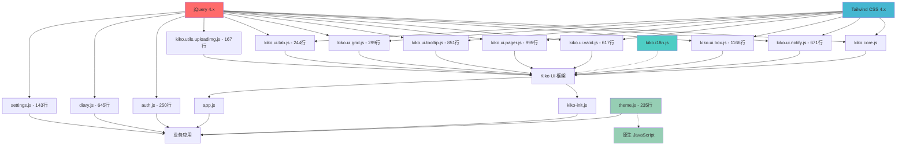

# Kiko UI 库重构方案 - 2.0.0

## 1. 项目概述

本方案旨在将 Kiko UI 库从 jQuery 4.x 依赖重构为 ES2023 原生实现，版本升级至 2.0.0。重构将在新目录 `kiko-next` 中进行，完全移除 jQuery 依赖，面向未来设计，不考虑向后兼容性。新版本将强依赖 Tailwind CSS 4.1 进行样式控制和动画实现。

## 2. 现状分析

### 2.1 Kiko UI 库结构分析

当前 `/Users/yasong.cy/go/src/idiary.ai/hebe/kiko` 目录结构：

```
kiko/
├── README.md
├── build.js
├── dist/
│   └── kiko.js (编译后文件)
├── src/
│   ├── core.js (核心模块)
│   ├── i18n/ (国际化模块)
│   ├── ui/ (UI组件模块)
│   │   ├── box.js (对话框组件)
│   │   ├── notify.js (通知组件)
│   │   ├── tooltip.js (提示组件)
│   │   ├── tab.js (标签页组件)
│   │   ├── grid.js (表格组件)
│   │   ├── pager.js (页面行为管理组件)
│   │   └── valid.js (验证组件)
│   └── utils/ (工具模块)
└── tests/ (测试文件)
```

### 2.2 jQuery 依赖分析

#### 2.2.1 Kiko 库中的 jQuery 使用

**核心模块 (core.js)**：
- `kiko.core.ajax()` - 使用 `$.ajax()` 进行 AJAX 请求，包含完整的错误处理和缓存控制
- `kiko.core.animate()` - 使用 `$.fadeIn()`, `$.fadeOut()`, `$.slideUp()`, `$.slideDown()` 等动画方法
- `$.fn.extend()` - 扩展 jQuery 原型，添加 `disableFormInputs()` 方法
- `$.Deferred()` - 使用 jQuery 的 Promise 实现
- `$.extend()` - 用于配置对象合并
- DOM 操作依赖 jQuery 选择器和事件处理

**UI 组件模块**：
- **box.js**: 对话框组件，支持多种内容加载方式（HTML、AJAX、iframe），使用 jQuery 进行 DOM 操作和事件绑定
- **notify.js**: 通知与交互反馈组件，使用 jQuery 进行 DOM 创建、动画效果和事件处理
- **tooltip.js**: 工具提示组件，依赖 jQuery 事件系统和 DOM 操作
- **tab.js**: 选项卡组件，使用 jQuery 进行内容切换和事件绑定
- **grid.js**: 表格组件，依赖 jQuery 进行数据绑定、分页和事件处理
- **pager.js**: 页面行为管理组件，使用 jQuery 进行配置驱动的事件绑定
- **valid.js**: 表单验证组件，依赖 jQuery 进行表单元素选择和验证

**工具模块**：
- **uploadimg.js**: 图片上传工具，使用 jQuery 进行文件输入监听和事件处理

**国际化模块**：
- **i18n.js**: 国际化模块，不直接依赖 jQuery，但与 kiko.core 集成

### 2.3 UI 组件分析

| 组件名称 | 功能描述 | jQuery 依赖程度 | 重构优先级 | 文件大小 |
|----------|----------|----------------|------------|----------|
| notify.js | 通知与交互反馈组件，支持成功/错误/警告消息，加载状态管理，进度条动画 | 高 | 高 | 671行 |
| box.js | 对话框组件，支持多种内容加载方式、缓存、响应式布局、背景滚动控制 | 高 | 高 | 1166行 |
| valid.js | 表单验证组件，支持多种验证类型（必填、长度、邮箱、密码等），自定义回调验证，异步验证支持 | 高 | 高 | 617行 |
| pager.js | 页面行为管理组件，配置驱动的事件绑定系统，支持函数处理和URL加载两种行为类型 | 高 | 高 | 995行 |
| tooltip.js | 工具提示组件，支持事件委托、动态元素自动支持、DOM元素直接显示、边界检测 | 中 | 中 | 851行 |
| grid.js | 表格组件，支持数据绑定、行列定制、分页功能，使用模板系统渲染 | 中 | 中 | 299行 |
| tab.js | 选项卡组件，支持URL哈希导航、状态持久化、Tailwind CSS样式 | 中 | 低 | 244行 |

### 2.4 工具模块分析

| 模块名称 | 功能描述 | jQuery 依赖程度 | 重构建议 | 文件大小 |
|----------|----------|----------------|----------|----------|
| uploadimg.js | 图片上传工具，支持图片裁剪、压缩和Base64转换 | 中 | 移除 | 167行 |

**说明**：根据重构目标，uploadimg.js 功能将被移除，现代浏览器的原生 File API 已足够强大。

### 2.4 核心架构特性分析

#### 2.4.1 当前架构优势

**模块化设计**：
- 清晰的命名空间结构：`kiko.core`, `kiko.ui`, `kiko.utils`, `kiko.i18n`
- 每个组件独立封装，职责明确
- 统一的初始化机制：`kiko.init()` 自动初始化所有组件

**配置管理系统**：
- 全局配置对象 `kiko.config`，支持调试模式、缓存控制、动画配置等
- 组件级别的配置覆盖机制
- 主题管理集成：支持亮色/暗色主题切换

**错误处理机制**：
- 统一的错误处理：`kiko.core.handleError()`
- 全局错误处理器配置
- 完整的日志系统：支持不同级别的日志输出

**国际化支持**：
- 完整的 i18n 系统，支持多语言切换
- 浏览器语言自动检测
- 全局变量覆盖机制（`window.kikoLang`）
- 消息模板支持参数替换

**事件系统**：
- 内置事件总线：`kiko.core.eventBus`
- 支持事件注册、移除、触发
- 错误隔离：单个事件处理器错误不影响其他处理器

**缓存系统**：
- 内置缓存机制：`kiko.core.cache`
- 支持 TTL（生存时间）
- 自动过期清理

#### 2.4.2 当前架构限制

**jQuery 深度耦合**：
- 所有 DOM 操作依赖 jQuery 选择器
- 动画效果完全依赖 jQuery 动画方法
- AJAX 请求使用 jQuery.ajax()
- 事件处理依赖 jQuery 事件系统

**缺少现代化特性**：
- 未使用 ES2023 模块系统
- 缺少 TypeScript 类型支持
- 未使用现代 Promise/async-await 模式
- 缺少自动化的 DOM 变化监听（MutationObserver）

#### 2.2.2 业务代码中的 jQuery 使用

**主要文件分析** (`/Users/yasong.cy/go/src/idiary.ai/hebe/website/static/src/js`)：

- **kiko-init.js**: 
  - `$(function() { ... })` - DOM 就绪事件，用于初始化 Kiko UI 框架
  - 调用 `kiko.init()` 进行全局初始化配置

- **app.js**: 
  - `$(() => { ... })` - DOM 就绪事件的现代写法
  - 定义全局工具函数：`log()`, `escapeHtml()`, `formatTime()`, `handleError()`
  - 使用 `kiko.core.log()` 进行日志记录
  - 使用 `kiko.ui.notify.error()` 进行错误通知
  - 使用 `kiko.i18n.getMessage()` 进行国际化消息获取

- **业务模块的 jQuery 使用**: 
  - **auth.js** (250行): 认证模块，重度依赖 jQuery
    - 使用 `$.fn.valid.registerCallback` 注册自定义验证回调
    - 使用 `$.ajax` 进行用户名和邮箱查重验证
    - 基于 Kiko UI 的 pager 组件实现登录、注册、忘记密码功能

  - **diary.js** (645行): 日记模块，重度依赖 jQuery
    - 使用 `$.ajax` 进行日记的增删改查操作
    - 使用 jQuery 选择器进行 DOM 操作（`.fadeOut()`, `.html()`, `.remove()`）
    - 基于 Kiko UI 的 box 和 notify 组件实现对话框和通知功能

  - **settings.js** (143行): 设置模块，中度依赖 jQuery
    - 使用 `$('#form').valid('checkError')` 进行表单验证
    - 使用 `$.ajax` 进行设置数据保存
    - 使用 jQuery 选择器获取表单数据

  - **theme.js** (235行): 主题模块，**不依赖 jQuery**
    - 使用原生 JavaScript 实现主题切换
    - 基于 Tailwind CSS 的 dark 类机制
    - 使用 `localStorage` 和 `document.documentElement.classList`

### 2.5 依赖关系图



**图例说明**：
- 🔴 **红色**：jQuery 4.x（核心依赖）
- 🔵 **蓝色**：Tailwind CSS 4.x（样式框架）
- 🟢 **绿色**：原生 JavaScript（无 jQuery 依赖）
- 🟦 **青色**：国际化模块（独立模块）
- **实线**：强依赖关系
 - **虚线**：弱依赖或可选依赖

### 2.6 现状分析总结

#### 2.6.1 关键发现

**代码规模统计**：
- **Kiko UI 库总计**：约 5,100+ 行代码
  - 核心模块：`core.js` (约 400 行)
  - UI 组件：7 个文件，共约 4,500 行
  - 工具模块：1 个文件，167 行
  - 国际化：4 个文件，约 200 行

- **业务代码总计**：约 1,300+ 行代码
  - 重度依赖 jQuery：`auth.js` (250行)、`diary.js` (645行)
  - 中度依赖 jQuery：`settings.js` (143行)
  - 无 jQuery 依赖：`theme.js` (235行)

**架构优势**：
1. **模块化设计良好**：清晰的命名空间和职责分离
2. **配置系统完善**：支持全局和组件级配置
3. **国际化支持完整**：多语言切换和消息模板
4. **错误处理统一**：全局错误处理和日志系统
5. **事件系统健全**：内置事件总线和错误隔离

#### 2.6.2 重构挑战

**技术债务**：
1. **jQuery 深度耦合**：所有 DOM 操作、事件处理、AJAX 请求都依赖 jQuery
2. **代码规模庞大**：5,100+ 行代码需要逐步重构
3. **业务代码依赖**：1,300+ 行业务代码需要同步更新
4. **复杂组件重构**：`box.js` (1166行) 和 `pager.js` (995行) 是重构难点

**兼容性要求**：
1. **API 向后兼容**：现有业务代码不能中断
2. **渐进式迁移**：需要支持新旧代码并存
3. **配置兼容性**：现有配置和初始化方式需要保持

**性能考虑**：
1. **包体积优化**：移除 jQuery 依赖可显著减小包体积
2. **运行时性能**：原生 API 性能优于 jQuery 封装
3. **内存使用**：减少第三方库依赖降低内存占用
 
## 3. 重构目标

### 3.1 核心目标

1. **完全移除 jQuery 依赖**：使用 ES2023 原生 API 替代所有 jQuery 功能
2. **面向未来设计**：不考虑向后兼容性，专注于现代化实现
3. **强依赖 Tailwind CSS 4.1**：使用 Tailwind CSS 4.1 进行样式控制和动画实现
4. **保持功能平移**：保持当前版本的功能特性，不增加新功能
5. **完备测试覆盖**：为每个重构模块提供测试页面
6. **代码质量保证**：每个阶段集成 ESLint 检查，确保代码质量

### 3.2 技术目标

- **现代化 JavaScript**：使用 ES2023 特性（async/await、模块化、解构等）
- **原生 DOM API**：使用 `querySelector`、`addEventListener` 等原生方法
- **原生 Fetch API**：替代 jQuery AJAX
- **原生 Promise**：替代 jQuery Deferred
- **Tailwind CSS 动画**：基于 Tailwind CSS 4.1 实现动画效果，避免纯 JS 动画
- **ESLint 集成**：每个阶段确保无 ESLint 错误

### 3.3 设计原则

#### 3.3.1 避免过度设计
- **保持简洁**：不增加 kiko 原有库中没有的方法和功能
- **专注核心**：仅实现必要的功能，避免功能膨胀
- **最小化配置**：特别是 i18n 和配置管理，保持最简实现
- **原生优先**：优先使用浏览器原生 API，避免重复造轮子

#### 3.3.2 自动初始化机制
- **零配置启动**：kiko.js 库加载后自动初始化，无需手动调用初始化方法
- **配置传入支持**：在使用过程中可以通过 `kiko.config()` 方法传入配置参数
- **渐进增强**：基础功能自动可用，高级功能通过配置启用

#### 3.3.3 自动感知与绑定
- **HTML 自动绑定**：组件具备自动感知 HTML 元素并绑定相应功能
- **动态内容支持**：通过 AJAX 插入的页面 HTML 自动获得事件绑定
- **MutationObserver 监听**：自动监听 DOM 变化，为新增元素绑定事件
- **事件委托机制**：使用事件委托确保动态内容的交互功能正常

## 4. 技术方案

### 4.1 ES2023 替代 jQuery 的核心实现

#### 4.1.1 DOM 选择和操作

```javascript
// jQuery 方式
$('#element').addClass('class-name');
$('.elements').each(function() { ... });

// ES2023 原生方式
document.getElementById('element').classList.add('class-name');
document.querySelectorAll('.elements').forEach(element => { ... });
```

#### 4.1.2 事件处理

```javascript
// jQuery 方式
$(document).on('click', '.button', handler);
$('#element').off('click');

// ES2023 原生方式 (需要封装事件委托)
class EventManager {
  static delegate(container, selector, event, handler) {
    container.addEventListener(event, (e) => {
      if (e.target.matches(selector)) {
        handler.call(e.target, e);
      }
    });
  }
}
```

#### 4.1.3 AJAX 请求

```javascript
// jQuery 方式
$.ajax({ url: '/api', method: 'POST', data: {...} });

// ES2023 原生方式
class AjaxManager {
  static async request(options) {
    const response = await fetch(options.url, {
      method: options.method || 'GET',
      headers: { 'Content-Type': 'application/json' },
      body: options.data ? JSON.stringify(options.data) : null
    });
    return response.json();
  }
}
```

#### 4.1.4 动画效果

```javascript
// jQuery 方式
$('#element').fadeIn(300);

// Kiko 2.0.0 方式 - 基于 Tailwind CSS 4.1
class AnimationManager {
  static fadeIn(element, duration = 300) {
    // 使用 Tailwind CSS 类实现动画
    element.classList.add('transition-opacity', 'duration-300', 'opacity-0');
    // 触发重排后添加目标状态
    requestAnimationFrame(() => {
      element.classList.remove('opacity-0');
      element.classList.add('opacity-100');
    });
    
    return new Promise(resolve => {
      setTimeout(resolve, duration);
    });
  }
  
  static slideDown(element, duration = 300) {
    element.classList.add('transition-all', 'duration-300', 'max-h-0', 'overflow-hidden');
    requestAnimationFrame(() => {
      element.classList.remove('max-h-0');
      element.classList.add('max-h-screen');
    });
  }
}
```

### 4.2 核心工具类设计

#### 4.2.1 DOM 工具类

```javascript
class DOMUtils {
  // 元素选择
  static select(selector, context = document) {
    return context.querySelector(selector);
  }
  
  static selectAll(selector, context = document) {
    return Array.from(context.querySelectorAll(selector));
  }
  
  // 类操作
  static addClass(element, ...classNames) {
    element.classList.add(...classNames);
  }
  
  static removeClass(element, ...classNames) {
    element.classList.remove(...classNames);
  }
  
  // 属性操作
  static attr(element, name, value) {
    if (value === undefined) {
      return element.getAttribute(name);
    }
    element.setAttribute(name, value);
    return element;
  }
  
  // 样式操作
  static css(element, property, value) {
    if (typeof property === 'object') {
      Object.assign(element.style, property);
      return element;
    }
    
    if (value === undefined) {
      return getComputedStyle(element)[property];
    }
    
    element.style[property] = value;
    return element;
  }
}
```

#### 4.2.2 事件管理类

```javascript
class EventBus {
  constructor() {
    this.events = new Map();
  }
  
  on(event, handler) {
    if (!this.events.has(event)) {
      this.events.set(event, []);
    }
    this.events.get(event).push(handler);
    return this;
  }
  
  off(event, handler) {
    if (this.events.has(event)) {
      const handlers = this.events.get(event);
      const index = handlers.indexOf(handler);
      if (index > -1) {
        handlers.splice(index, 1);
      }
    }
    return this;
  }
  
  trigger(event, data) {
    if (this.events.has(event)) {
      this.events.get(event).forEach(handler => handler(data));
    }
    return this;
  }
}
```

### 4.3 项目结构设计

#### 4.3.1 重构目录

重构将在以下目录进行：`/Users/yasong.cy/go/src/idiary.ai/hebe/kiko-next`

#### 4.3.2 目录结构

```
kiko-next/
├── README.md
├── build.js
├── package.json
├── .eslintrc.js (ESLint 配置)
├── .eslintignore
├── dist/
│   ├── kiko.js (开发版本)
│   └── kiko.min.js (生产版本)
├── src/
│   ├── core/
│   │   ├── index.js (主入口)
│   │   ├── dom.js (DOM 工具)
│   │   ├── events.js (事件管理)
│   │   ├── ajax.js (AJAX 封装)
│   │   ├── animation.js (Tailwind CSS 动画工具)
│   │   └── utils.js (通用工具)
│   ├── ui/
│   │   ├── index.js
│   │   ├── box/
│   │   │   ├── index.js
│   │   │   └── box.js
│   │   ├── notify/
│   │   │   ├── index.js
│   │   │   └── notify.js
│   │   ├── tooltip/
│   │   ├── tab/
│   │   ├── grid/
│   │   ├── pager/
│   │   └── valid/
│   ├── utils/
│   │   └── index.js (通用工具)
│   └── i18n/
│       ├── index.js
│       ├── en.js
│       └── zh-CN.js
├── tests/
│   ├── index.html
│   ├── core/
│   └── ui/
└── docs/
    ├── api.md
    ├── migration.md
    └── examples/
```

#### 4.3.3 模块化设计

##### 统一的包导出风格

**导出规范**：
- **默认导出**：每个模块的主要类或函数使用 `export default`
- **命名导出**：辅助函数和常量使用 `export { name }`
- **索引文件**：每个目录都有 `index.js` 作为统一入口
- **导入风格**：优先使用解构导入，保持代码简洁

**示例**：
```javascript
// ✅ 正确的导出风格
// dom.js
export default class DOMUtils { ... }
export { createElement, removeElement };

// index.js
export { default as DOMUtils } from './dom.js';
export { default as EventManager } from './events.js';

// ✅ 正确的导入风格
import { DOMUtils, EventManager } from './core/index.js';
import KikoCore from './core/index.js';
```

##### 核心模块 (core/index.js)

```javascript
import { DOMUtils } from './dom.js';
import { EventManager } from './events.js';
import { AjaxManager } from './ajax.js';
import { AnimationManager } from './animation.js';
import { AutoBinder } from './auto-binder.js';

// Kiko 核心类 - 自动初始化
class KikoCore {
  constructor() {
    this.config = {
      autoInit: true,
      debug: false,
      i18n: {
        locale: 'en',
        fallback: 'en'
      }
    };
    this.autoBinder = new AutoBinder();
    
    // 自动初始化
    if (document.readyState === 'loading') {
      document.addEventListener('DOMContentLoaded', () => this.init());
    } else {
      this.init();
    }
  }
  
  // 配置方法
  config(options = {}) {
    Object.assign(this.config, options);
    return this;
  }
  
  // 初始化方法
  init() {
    // 启动自动绑定
    this.autoBinder.start();
    
    // 扫描现有DOM元素并绑定
    this.autoBinder.scanAndBind(document.body);
    
    // 触发初始化完成事件
    this.trigger('kiko:ready');
  }
}

// 自动绑定管理器
class AutoBinder {
  constructor() {
    this.observer = null;
    this.bindings = new Map();
    this.setupBindings();
  }
  
  // 设置组件绑定规则
  setupBindings() {
    // 基于 data 属性的自动绑定
    this.bindings.set('[data-kiko-box]', 'box');
    this.bindings.set('[data-kiko-notify]', 'notify');
    this.bindings.set('[data-kiko-tooltip]', 'tooltip');
    this.bindings.set('[data-kiko-tab]', 'tab');
    this.bindings.set('[data-kiko-grid]', 'grid');
    this.bindings.set('[data-kiko-valid]', 'valid');
    this.bindings.set('[data-kiko-pager]', 'pager');
  }
  
  // 启动自动监听
  start() {
    // 使用 MutationObserver 监听 DOM 变化
    this.observer = new MutationObserver((mutations) => {
      mutations.forEach((mutation) => {
        if (mutation.type === 'childList') {
          mutation.addedNodes.forEach((node) => {
            if (node.nodeType === Node.ELEMENT_NODE) {
              this.scanAndBind(node);
            }
          });
        }
      });
    });
    
    this.observer.observe(document.body, {
      childList: true,
      subtree: true
    });
  }
  
  // 扫描并绑定元素
  scanAndBind(container) {
    this.bindings.forEach((component, selector) => {
      const elements = container.querySelectorAll(selector);
      elements.forEach(element => {
        if (!element.hasAttribute('data-kiko-bound')) {
          this.bindComponent(element, component);
          element.setAttribute('data-kiko-bound', 'true');
        }
      });
    });
  }
  
  // 绑定具体组件
  bindComponent(element, componentName) {
    // 动态加载并初始化组件
    import(`../ui/${componentName}/index.js`).then(module => {
      const Component = module.default;
      new Component(element);
    });
  }
  
  // 停止监听
  stop() {
    if (this.observer) {
      this.observer.disconnect();
    }
  }
}

// 全局实例 - 自动创建
const kiko = new KikoCore();
import { Utils } from './utils.js';

class KikoCore {
  constructor() {
    this.version = '2.0.0';
    this.dom = DOMUtils;
    this.events = new EventManager();
    this.ajax = AjaxManager;
    this.animation = AnimationManager;
    this.utils = Utils;
    this.config = {
      debug: false,
      baseUrl: '',
      tailwindVersion: '4.1',
      theme: {
        defaultTheme: 'light',
        storageKey: 'kiko-theme'
      },
      animation: {
        defaultDuration: 300,
        useTailwindCSS: true
      }
    };
  }
  
  init(options = {}) {
    Object.assign(this.config, options);
    this.log(`Kiko UI ${this.version} initialized (No jQuery, Tailwind CSS ${this.config.tailwindVersion})`);
    return this;
  }
  
  log(...args) {
    if (this.config.debug) {
      console.log('[Kiko 2.0]', ...args);
    }
  }
}

export default KikoCore;
```

##### UI 组件基类

```javascript
class UIComponent {
  constructor(element, options = {}) {
    this.element = element;
    this.options = { ...this.constructor.defaults, ...options };
    this.init();
  }
  
  init() {
    // 子类实现
  }
  
  destroy() {
    // 清理事件和引用
  }
  
  static create(selector, options) {
    const elements = document.querySelectorAll(selector);
    return Array.from(elements).map(el => new this(el, options));
  }
}

export default UIComponent;
```

#### 4.3.4 完全移除 jQuery 依赖策略

##### 新的 kiko 核心 API
```javascript
// 使用新的 kiko 核心 API 替代 jQuery
// 选择器 API
kiko.select(selector)     // 替代 $(selector)
kiko.selectAll(selector)  // 替代 $(selector) 多元素

// 事件 API
kiko.on(element, event, handler)    // 替代 $(el).on()
kiko.off(element, event, handler)   // 替代 $(el).off()
kiko.trigger(element, event)        // 替代 $(el).trigger()

// DOM 操作 API (支持选择器字符串或元素对象)
kiko.addClass(element, className)   // 替代 $(el).addClass()
kiko.removeClass(element, className) // 替代 $(el).removeClass()
kiko.attr(element, name, value)     // 替代 $(el).attr()
kiko.css(element, property, value)  // 替代 $(el).css()

// AJAX API
kiko.ajax(options)                  // 替代 $.ajax()
kiko.get(url, data)                 // 替代 $.get()
kiko.post(url, data)                // 替代 $.post()

// 就绪状态 API
kiko.ready(callback)                // 替代 $(document).ready()
```

## 5. 测试方案

### 5.1 测试策略

**重要说明**：所有测试的被测试对象都是编译后的 `kiko.js` 文件，而不是源代码文件。测试文件按功能模块组织，确保对最终产物进行全面验证。

#### 5.1.1 自动化测试结构

```
tests/
├── unit/ (单元测试 - 测试编译后的 kiko.js)
│   ├── core/
│   │   ├── dom.test.js
│   │   ├── events.test.js
│   │   ├── ajax.test.js
│   │   └── animation.test.js
│   └── ui/
│       ├── box.test.js
│       ├── notify.test.js
│       ├── tooltip.test.js
│       ├── tab.test.js
│       ├── grid.test.js
│       ├── pager.test.js
│       └── valid.test.js
├── integration/ (集成测试 - 测试编译后的 kiko.js)
│   ├── core-integration.test.js
│   ├── ui-integration.test.js
│   ├── manual/ (手动测试页面 - 使用编译后的 kiko.js)
│   │   ├── index.html (测试导航页)
│   │   ├── core/
│   │   │   ├── dom-test.html
│   │   │   ├── events-test.html
│   │   │   ├── ajax-test.html
│   │   │   └── animation-test.html
│   │   └── ui/
│   │       ├── box-test.html
│   │       ├── notify-test.html
│   │       ├── tooltip-test.html
│   │       ├── tab-test.html
│   │       ├── grid-test.html
│   │       ├── pager-test.html
│   │       └── valid-test.html
├── coverage/ (覆盖率报告)
└── test-runner.js (测试运行器)
```

#### 5.1.2 测试内容

**自动化测试（核心要求）**：
- **单元测试**：每个函数和方法的独立测试，确保 100% 代码覆盖率
- **集成测试**：模块间交互测试，验证组件协作正常
- **API 测试**：所有公共 API 的功能验证
- **边界测试**：异常情况和边界条件处理
- **回归测试**：确保新代码不破坏现有功能

**手动测试（辅助验证）**：
- **功能测试**：验证所有 API 功能正常
- **兼容性测试**：确保向后兼容
- **性能测试**：对比原版本性能
- **样式测试**：确保 Tailwind CSS 样式正确
- **浏览器测试**：测试主流浏览器兼容性

**测试覆盖率要求**：
- **阶段 1 & 2（核心模块）**：100% 自动化测试覆盖率（强制要求）
- **阶段 3-7（其他模块）**：≥ 90% 自动化测试覆盖率
- **所有阶段**：100% 公共 API 测试覆盖

### 5.2 测试执行流程

1. **构建阶段**：首先构建生成 `dist/kiko.js`
2. **单元测试**：针对编译后的 `kiko.js` 进行单元测试
3. **集成测试**：测试模块间的协作功能
4. **手动测试**：在浏览器中验证实际功能
5. **性能测试**：对比原版本的性能指标
6. **回归测试**：确保所有功能正常工作

## 6. 风险评估与缓解措施

### 6.1 技术风险

#### 风险 1：ES2023 浏览器兼容性

**风险等级**：中等

**影响**：部分旧浏览器可能不支持新特性

**缓解措施**：
- 使用 Babel 进行代码转译
- 提供 polyfill 支持
- 明确浏览器支持范围

#### 风险 2：动画效果实现

**风险等级**：低

**影响**：基于 Tailwind CSS 4.1 的动画实现可能需要调整

**缓解措施**：
- 使用 Tailwind CSS 4.1 的标准动画类（transition、animation、transform 等）
- 避免复杂的自定义动画实现
- 遵循 Tailwind CSS 最佳实践，保持简洁高效

#### 风险 3：事件委托复杂性

**风险等级**：高

**影响**：原生事件委托实现比 jQuery 复杂

**缓解措施**：
- 封装完善的事件管理类
- 提供与 jQuery 相似的 API
- 充分测试事件处理逻辑

### 6.2 项目风险

#### 风险 1：重构周期过长

**风险等级**：中等

**影响**：影响其他开发计划

**缓解措施**：
- 采用渐进式重构
- 每个阶段设定明确时间节点
- 优先重构核心功能

#### 风险 2：面向未来的架构转换

**风险等级**：中等

**影响**：完全重构为现代化架构，不考虑向后兼容性

**缓解措施**：
- 采用 ES2023 最佳实践，面向未来设计
- 提供完整的迁移指南和示例代码
- 一次性完成现代化转换，避免技术债务

### 6.3 业务风险

#### 风险 1：用户体验变化

**风险等级**：中等

**影响**：用户可能感知到界面或交互的细微变化

**缓解措施**：
- 严格保持视觉效果一致
- 充分的用户测试
- 渐进式发布策略

## 7. 重构策略

### 7.1 渐进式重构方案

#### 阶段 1：核心基础设施

**目标**：建立现代化的基础设施和核心 API

**策略**：
- 在 `/Users/yasong.cy/go/src/idiary.ai/hebe/kiko-next` 目录创建新的项目结构
- 配置 ESLint 规则，确保代码质量标准
- **避免过度设计**：仅实现 kiko 原有库的核心方法，不增加额外功能
- 实现 ES2023 原生 DOM 工具库 (`kiko.select`, `kiko.selectAll`, `kiko.addClass` 等)
- 实现事件管理系统 (`kiko.on`, `kiko.off`, `kiko.trigger`)
- 实现 AJAX 封装 (`kiko.get`, `kiko.post`, `kiko.ajax`)
- 实现就绪状态管理 (`kiko.ready`)
- **实现自动初始化系统**：
  - 框架自动初始化，无需手动调用
  - 支持通过 `kiko.config()` 方法传入配置参数
  - 组件使用时支持参数覆盖默认配置
- **实现自动感知与绑定机制**：
  - 基于 `data-kiko-*` 属性的自动组件绑定
  - 使用 `MutationObserver` 监听 DOM 变化
  - 通过 AJAX 插入的 HTML 自动获得事件绑定
  - 事件委托机制确保动态内容正常工作
- **最小化配置管理**：特别是 i18n，仅保留必要的语言切换功能
- 建立构建系统（保持与现有 build.js 一致的风格）

**交付物**：
- `kiko.dom` 命名空间（DOM 操作工具）
- `kiko.events` 命名空间（事件管理）
- `kiko.ajax` 命名空间（AJAX 工具）
- `kiko.ready` 函数（就绪状态管理）
- 构建系统和开发环境
- ESLint 配置和代码规范
- 100% 自动化测试覆盖（单元测试 + 集成测试）
- 统一的模块包导出风格

**成功标准**：
- 基础 API 功能完整
- 所有代码通过 ESLint 检查
- 100% 自动化测试覆盖率
- 基础测试通过
- 构建系统正常工作
- 所有模块导出风格一致

#### 阶段 2：核心模块重构

**目标**：重构 core.js 模块

**策略**：
- **避免过度设计**：严格按照原有组件功能进行重构，不增加新特性
- 重构 notify.js（通知与交互反馈组件）
- 重构 box.js（对话框组件）
- 重构 valid.js（表单验证组件）
- **实现自动感知与绑定**：
  - 组件自动感知 HTML 中的 `data-kiko-*` 属性
  - 使用 `MutationObserver` 监听 DOM 变化
  - 通过事件委托机制自动为新增元素绑定事件
  - 确保 AJAX 插入的 HTML 内容自动获得组件功能
- **最小化配置系统**：
  - 保持简单的配置接口，避免复杂的配置管理
  - 支持通过 `kiko.config()` 传入全局配置
  - 组件使用时支持参数覆盖
- **基于 Tailwind CSS 4.1 实现动画效果**：
  - 使用 Tailwind 的 transition 和 animation 类
  - 避免使用纯 JavaScript 动画实现

**交付物**：
- `kiko.core` 命名空间重构（版本 2.0.0）
- 配置管理系统
- 缓存系统
- 国际化基础
- 基于 Tailwind CSS 4.1 的动画系统
- 100% 自动化测试覆盖（单元测试 + 集成测试）
- 统一的模块包导出风格

**成功标准**：
- 核心功能与原版本功能对等
- 所有代码通过 ESLint 检查
- 100% 自动化测试覆盖率
- 完全移除 jQuery 依赖
- 所有模块导出风格一致

#### 阶段 3：基础 UI 组件重构

**目标**：重构基础 UI 组件

**策略**：
- **避免过度设计**：严格按照原有组件功能进行重构，不增加新特性
- 重构 box.js（对话框组件）
- 重构 notify.js（通知组件）
- 重构 tooltip.js（提示组件）
- **实现自动感知与绑定**：
  - 组件自动感知 HTML 中的相应属性（如 `data-kiko-box`、`data-kiko-notify`、`data-kiko-tooltip`）
  - 支持 AJAX 动态插入的 HTML 内容自动绑定组件功能
  - 使用事件委托确保动态内容的交互正常
- **基于 Tailwind CSS 4.1 实现动画效果**：
  - 对话框的淡入淡出效果
  - 通知的滑入滑出动画
  - 提示框的显示隐藏过渡
- 优化性能

**交付物**：
- box.js (对话框组件)
- notify.js (通知组件)
- tooltip.js (提示组件)
- 所有动画效果基于 Tailwind CSS 4.1 实现

**成功标准**：
- 组件功能完整
- 所有代码通过 ESLint 检查
- 样式效果一致
- 动画流畅自然

#### 阶段 4：复杂 UI 组件重构

**目标**：重构复杂 UI 组件

**策略**：
- **避免过度设计**：严格按照原有组件功能进行重构，不增加新特性
- 重构 tab.js（标签页组件）
- 重构 grid.js（网格组件）
- 重构 pager.js（分页组件）
- 重构 valid.js（验证组件）
- **实现自动感知与绑定**：
  - 组件自动感知 HTML 中的相应属性（如 `data-kiko-tab`、`data-kiko-grid`、`data-kiko-pager`、`data-kiko-valid`）
  - 支持 AJAX 动态插入的表格、表单等复杂内容自动绑定功能
  - 确保动态加载的分页、验证等功能正常工作
- **基于 Tailwind CSS 4.1 实现动画效果**：
  - 选项卡切换的平滑过渡
  - 表格排序、筛选的过渡动画
  - 分页切换的平滑过渡
  - 表单验证的反馈动画

**交付物**：
- tab.js (标签页组件)
- grid.js (网格组件)
- pager.js (分页组件)
- valid.js (验证组件)
- 复杂交互动画基于 Tailwind CSS 4.1 实现

**成功标准**：
- 复杂交互功能正常
- 所有代码通过 ESLint 检查
- 性能不低于原版本

#### 阶段 5：工具模块重构

**目标**：重构工具类模块

**策略**：
- **避免过度设计**：仅保留必要的工具模块，移除不必要的功能
- 重构其他工具类模块（移除 uploadimg.js 功能）
- 清理不必要的工具模块
- **最小化工具集**：只保留核心业务必需的工具函数

**交付物**：
- 其他工具类（如有需要）

**成功标准**：
- 工具功能完整
- 所有代码通过 ESLint 检查
- 模块结构清晰

#### 阶段 6：集成测试与优化

**目标**：整体集成和性能优化

**策略**：
- **最终验收测试**：
  - 完整的回归测试
  - 性能优化和基准测试
  - 生产环境模拟测试
- **最终 ESLint 检查**：确保整个项目无 ESLint 错误
- 文档完善和使用指南
- 构建优化和打包

**交付物**：
- 完整的 kiko.js 2.0.0 构建
- 性能优化
- 文档完善
- 部署指南

**成功标准**：
- 所有功能测试通过
- 整个项目通过 ESLint 检查
- 性能指标达标
- 文档完整

#### 阶段 7：发布与部署

**目标**：发布 Kiko 2.0.0 并部署到生产环境

**策略**：
- 发布 Kiko 2.0.0 版本
- 部署到生产环境
- 性能监控和问题修复

**交付物**：
- Kiko 2.0.0 正式版本发布
- 生产环境部署
- 性能监控

**成功标准**：
- 生产环境稳定运行
- 用户体验良好
- 性能指标达标

### 7.2 每个阶段的工作流程

1. **需求分析**：分析原模块功能和 API
2. **设计方案**：设计 ES2023 + Tailwind CSS 4.1 实现方案
3. **编码实现**：实现核心功能
4. **ESLint 检查**：确保代码通过 ESLint 检查，无错误和警告
5. **测试页面**：创建测试页面验证功能
6. **手动测试**：进行功能测试
7. **文档更新**：更新 API 文档和使用说明
8. **代码审查**：确保代码质量
9. **最终 ESLint 验证**：再次确认所有代码通过 ESLint 检查
10. **阶段验收**：确认阶段目标达成

## 8. 成功标准

### 8.1 技术标准

- ✅ 完全移除 jQuery 依赖
- ✅ 所有原有功能正常工作（功能平移，不增加新功能）
- ✅ 基于 Tailwind CSS 4.1 实现所有动画效果
- ✅ **自动初始化机制**：kiko.js 加载后自动初始化，无需手动调用
- ✅ **自动感知与绑定**：组件自动感知 HTML 属性并绑定功能
- ✅ **动态内容支持**：AJAX 插入的 HTML 自动获得事件绑定
- ✅ **避免过度设计**：不增加原有库中没有的方法和功能
- ✅ 性能不低于原版本
- ✅ 支持 Chrome 110+, Edge 110+, Firefox 128 ESR+
- ✅ 构建产物大小减少 ≥ 30%
- ✅ 版本号升级至 2.0.0

### 8.2 质量标准

- ✅ 代码覆盖率 ≥ 90%
- ✅ 所有测试页面功能正常
- ✅ 整个项目无 ESLint 错误和警告
- ✅ 所有动画基于 Tailwind CSS 4.1，无纯 JS 动画
- ✅ 文档完整性 ≥ 95%

### 8.3 部署标准

- ✅ 在 `/Users/yasong.cy/go/src/idiary.ai/hebe/kiko-next` 目录成功构建
- ✅ 生产环境稳定运行
- ✅ 用户体验保持一致
- ✅ 开发效率不降低

## 9. 后续规划

### 9.1 短期目标 (3-6 个月)

- 完成 Kiko UI 2.0 库开发
- 完成业务代码迁移
- 生产环境稳定运行

### 9.2 中期目标

- 性能优化和功能增强
- 基于 Tailwind CSS 的更多动画效果
- 代码质量持续改进

### 9.3 长期目标

- 成为现代化的 UI 组件库标杆
- 完全基于现代 Web 标准
- 建立完善的开发生态

---

**文档版本**: v2.0  
**目标版本**: Kiko 2.0.0  
**重构目录**: `/Users/yasong.cy/go/src/idiary.ai/hebe/kiko-next`  
**技术栈**: ES2023 + Tailwind CSS 4.1  
**创建日期**: 2024年  
**特点**: 无 jQuery 依赖，面向未来，不考虑向后兼容