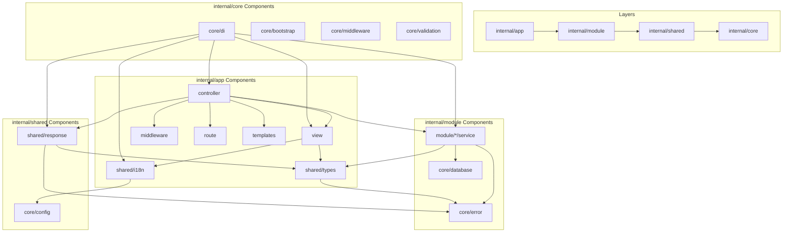

# Go 项目 `Render` 模块重构指南：追求最佳实践

## 1. 项目现状分析

### 1.1 现有目录结构概览

您当前的项目采用了常见的分层架构，但 `render` 模块的定位和依赖关系存在一些挑战：

```
internal/
├── core/              # 基础设施层 (config, error, database, di, bootstrap, middleware, validation)
│   ├── config/        # 配置管理
│   ├── error/         # 错误处理
│   ├── database/      # 数据库连接
│   ├── di/            # 依赖注入
│   ├── bootstrap/     # 启动引导
│   ├── middleware/    # 中间件
│   └── validation/    # 验证
├── app/              # 应用层 (controller, route, middleware, bootstrap, templates)
│   ├── render/        # 渲染模块（当前问题所在，职责混杂）
│   │   ├── localization/  # 国际化管理
│   │   ├── page/          # 页面构建
│   │   ├── response/      # HTTP响应处理
│   │   ├── types/         # 类型定义
│   │   ├── service.go     # 渲染服务
│   │   ├── interfaces.go  # 接口定义
│   │   └── types.go       # 页面数据结构
│   ├── controller/    # 控制器
│   ├── route/         # 路由
│   ├── middleware/    # 中间件
│   ├── bootstrap/     # 启动引导
│   └── templates/     # 模板
└── module/           # 业务模块层 (user, diary, post, task)
    ├── user/         # 用户模块
    ├── diary/        # 日记模块
    ├── post/         # 文章模块
    └── task/         # 任务模块
```

### 1.2 `Render` 模块内部结构 (`internal/app/render/`)

`render` 模块当前包含多个子包，承担了页面渲染之外的多种职责：

```
internal/app/render/
├── localization/          # 国际化管理
│   ├── manager.go
│   ├── loader.go
│   └── normalizer.go
├── page/                 # 页面构建 (page_builder.go, context_builder.go, breadcrumb_strategies.go)
├── response/             # HTTP响应处理 (handler.go, interfaces.go)
├── types/                # 类型定义 (types.go，包含 RenderUser 接口等)
├── service.go            # 渲染服务（门面）
├── interfaces.go         # 服务接口
└── types.go              # 页面数据结构
```

### 1.3 当前依赖关系及问题

核心问题在于 `render` 模块的职责边界模糊和不健康的依赖关系：

```mermaid
graph TD
    A[internal/core/]
    B[internal/app/render/]
    C[internal/module/*/handler]

    B -- 引用 --> A
    C -- 引用 --> B  (❌ 模块层不应依赖应用层细节)

    subgraph internal/app/render/ details
        B1[localization]
        B2[page]
        B3[response]
        B4[types (contains RenderUser interface)]
        B5[service.go]
        B6[interfaces.go]
        B7[types.go]
    end

    B5 -- orchestrates --> B1
    B5 -- orchestrates --> B2
    B5 -- orchestrates --> B3
    B5 -- uses --> B4

    C -- implements RenderUser --> B4 (Implied unhealthy dependency where module depends on app/render/types for interface)
```

**具体问题点：**

1.  **职责混乱 (Responsibility Confusion)**: `render` 模块承担了页面数据组装、HTTP 响应处理、模板函数管理、用户上下文管理、面包屑导航以及国际化管理等多个不相关的职责，严重违反了单一职责原则。
2.  **依赖关系复杂且不健康**:
    - `module` 层（业务逻辑核心）依赖 `app/render`（应用层细节），这违反了分层架构中"上层不依赖下层"或至少不依赖非通用应用层细节的原则。
    - `render/types` 中定义的 `RenderUser` 接口，却在 `module/user` 中实现。这意味着 `module/user`（核心业务模块）依赖了一个属于 `app/render`（特定应用渲染层）的接口，形成了**潜在的循环依赖风险**。如果 `render` 自身又需要使用 `user` 模块提供的某种能力，就会直接形成循环。
3.  **通用组件未下沉**: 国际化、通用数据类型 (`PageData`, `JSONResponse`) 和通用 HTTP 响应处理，这些应该是跨应用层和业务模块层共享的通用能力，不应被封装在特定的 `app/render` 模块中。它们应该位于一个更低、更通用的层级。
4.  **可测试性挑战**: 职责耦合导致测试困难，需要模拟大量不相关的依赖。

---

## 2. "最佳实践"重构方案

为了彻底解决上述问题，消除历史包袱，并为项目未来的扩展和 AI 驱动特性奠定坚实基础，我们采用**严格按职责和依赖方向拆分**的"最佳实践"方案。

### 2.1 核心设计理念

- **严格分层**: 建立清晰的依赖方向：`internal/core` → `internal/shared` → `internal/module` → `internal/app`。**绝不允许逆向依赖或循环依赖**。
- **职责单一**: 每个 Go 包（或模块）都应只关注一项明确的职责。
- **依赖倒置**: 高层模块应依赖抽象（接口），而不是低层模块的具体实现。
- **高内聚低耦合**: 模块内部高内聚，模块之间低耦合。
- **分阶段实施**: 采用渐进式重构，每个阶段都要验证，降低风险。

### 2.2 最终目标目录结构

```
internal/
├── core/              # 基础设施层：通用、底层、无业务依赖，项目核心运行环境
│   ├── config/        # 配置管理
│   ├── error/         # 错误处理 (AppError, ErrorCodes)
│   ├── database/      # 数据库连接、ORM 初始化
│   ├── di/            # 依赖注入容器
│   ├── bootstrap/     # 应用启动引导流程
│   ├── middleware/    # 通用 HTTP 中间件 (如日志、请求ID)
│   └── validation/    # 通用数据验证器
│
├── shared/            # 共享层：跨领域通用、无业务依赖，解决高层依赖问题
│   ├── types/         # 共享类型定义 (接口和结构体)
│   │   ├── interfaces.go  # RenderUser 接口等核心接口
│   │   └── structs.go     # PageData, RenderContext, BreadcrumbItem, JSONResponse, ErrorResponse 等结构体
│   ├── i18n/          # 国际化服务
│   │   ├── service.go     # LocalizationManager 实现
│   │   └── interfaces.go  # I18nManager 接口定义
│   └── response/      # 通用 HTTP 响应处理
│       ├── service.go     # ResponseHandler 实现
│       └── interfaces.go  # ResponseHandler 接口定义
│
├── module/            # 业务模块层：领域核心逻辑，只依赖 core 和 shared
│   ├── user/          # 用户模块
│   ├── diary/         # 日记模块
│   ├── post/          # 文章模块
│   └── task/          # 任务模块
│
└── app/               # 应用层：API接口、UI渲染、业务流程编排，依赖 module 和 shared
    ├── controller/    # HTTP 控制器
    ├── middleware/    # 应用特定中间件 (如认证、会话管理)
    ├── route/         # 路由定义
    ├── bootstrap/     # 应用层启动引导
    ├── templates/     # HTML 模板文件
    └── view/          # 视图构建层：专注于 HTML 页面数据组装与渲染
        ├── service.go     # ViewService 实现
        ├── interfaces.go  # ViewService 接口
        ├── page_data_builder.go # 页面数据构建器
        └── context_builder.go   # 渲染上下文构建器
```

### 2.3 关键组件职责与依赖关系细化

1.  **`internal/shared/types`**:

    - **职责**: 定义所有跨层（`module` 和 `app`）共享的、且不包含业务逻辑的**通用接口**和**数据结构**。
    - **内容**: `RenderUser` 接口、`RenderContext` 结构体、`PageData` 结构体、`BreadcrumbItem` 结构体、`JSONResponse`、`ErrorResponse` 结构体等。
    - **依赖**: 无（最底层、最通用的共享）
    - **解决问题**: 彻底消除 `RenderUser` 接口在 `app/render/types` 中定义导致 `module` 层依赖 `app` 层的循环依赖。现在 `module/user` 可以实现 `shared/types.RenderUser`，而 `app/view` 和 `shared/response` 都可以安全地使用它。

2.  **`internal/shared/i18n`**:

    - **职责**: 提供独立的国际化和本地化服务，负责语言消息的加载、管理和获取。
    - **内容**: `I18nManager` 接口定义和 `LocalizationManager` 实现。
    - **依赖**: `internal/core/config` (获取语言配置)、标准库。
    - **解决问题**: 国际化是通用能力，应下沉到共享层，使其可以在整个应用中（包括 `app/view`、`module` 内部需要国际化错误信息等场景）被复用，而不是仅限于 `render` 模块。通过接口定义提高可测试性和可扩展性。

3.  **`internal/shared/response`**:

    - **职责**: 封装通用的 HTTP JSON 和 HTML 响应逻辑，不依赖具体的页面数据组装。
    - **内容**: `ResponseHandler` 接口定义和 `ResponseHandler` 实现，包含 `JSON`、`JSONSuccess`、`JSONError`、`HTML`、`HTMLError`、`Redirect` 等方法。
    - **依赖**: `internal/core/error` (处理自定义错误)、`github.com/gin-gonic/gin`、标准库。
    - **解决问题**: HTTP 响应是通用行为，应独立于特定的"渲染页面"职责。`app/controller` 可以直接使用此服务发送响应，无需通过一个大的 `render` 门面。通过接口定义提高可测试性和可扩展性。

4.  **`internal/app/view`**:

    - **职责**: **唯一**专注于 HTML 页面的数据组装、上下文构建和渲染前的准备工作，以及提供注册模板函数的能力。
    - **内容**: `ViewService` 实现，以及内部辅助构建器如 `PageDataBuilder`、`ContextBuilder`、`BreadcrumbStrategy`。
    - **依赖**: `internal/shared/types` (获取 `PageData`, `RenderContext`, `RenderUser` 等结构体)、`internal/shared/i18n` (获取翻译消息)、`internal/core/config`、`github.com/gin-gonic/gin`。
    - **解决问题**: 将复杂的页面数据组装逻辑封装在一起，使其职责单一且明确，且明确其只依赖于共享层和核心层。

5.  **`internal/app/controller`**:

    - **职责**: 处理 HTTP 请求，作为协调器，协调业务逻辑 (`module` 服务) 和视图渲染 (`app/view` 服务)。
    - **内容**: 各个业务模块的 HTTP 控制器。
    - **依赖**:
      - `internal/module/*/service` (通过接口调用业务逻辑)
      - `internal/app/view.ViewService` (获取页面数据)
      - `internal/shared/response.ResponseHandler` (发送响应)
      - `github.com/gin-gonic/gin`、`internal/core/error`、`internal/core/config`。
    - **解决问题**: 控制器变得非常薄，主要负责参数解析、调用业务逻辑、根据结果调用视图层组装数据、最后调用响应层发送数据。

### 2.4 新的依赖关系流

这将建立一个清晰、单向的依赖关系流，彻底消除循环依赖：



**核心原则**：箭头永远从高层指向低层，**绝不允许逆向依赖或循环依赖**。

### 2.5 重构实施步骤 (分阶段进行，降低风险)

为了确保重构过程可控且成功，采用**分阶段渐进式重构**，每个阶段都要验证通过。

#### 阶段1：准备阶段 (1天)

**目标**: 确保重构基础稳固

1.  **全面测试覆盖**: 确保现有项目有足够的单元测试、集成测试和端到端测试，它们将是重构成功的"安全网"。
2.  **熟悉 DI 容器**: 确保熟悉 `internal/core/di` 的使用方式，所有拆分后的组件都将通过它进行依赖注入。
3.  **创建新目录结构**:
    ```bash
    mkdir -p internal/shared/types
    mkdir -p internal/shared/i18n
    mkdir -p internal/shared/response
    mkdir -p internal/app/view
    ```

#### 阶段2：迁移共享类型 (1天)

**目标**: 解决循环依赖的核心问题

1.  **迁移类型定义**:
    ```bash
    # 迁移类型定义到shared层
    cp internal/app/render/types/types.go internal/shared/types/structs.go
    cp internal/app/render/types/types.go internal/shared/types/interfaces.go
    ```
2.  **更新import路径**:
    ```bash
    find . -name "*.go" -exec sed -i '' 's/internal\/app\/render\/types/internal\/shared\/types/g' {} \;
    ```
3.  **验证编译**:
    ```bash
    go build ./cmd/idiary
    go test ./internal/shared/types/...
    ```

#### 阶段3：迁移国际化服务 (1天)

**目标**: 将通用能力下沉到共享层

1.  **迁移国际化服务**:
    ```bash
    cp internal/app/render/localization/* internal/shared/i18n/
    ```
2.  **更新import路径**:
    ```bash
    find . -name "*.go" -exec sed -i '' 's/internal\/app\/render\/localization/internal\/shared\/i18n/g' {} \;
    ```
3.  **验证编译**:
    ```bash
    go build ./cmd/idiary
    go test ./internal/shared/i18n/...
    ```

#### 阶段4：迁移响应处理 (1天)

**目标**: 分离HTTP响应处理职责

1.  **迁移响应处理**:
    ```bash
    cp internal/app/render/response/* internal/shared/response/
    ```
2.  **更新import路径**:
    ```bash
    find . -name "*.go" -exec sed -i '' 's/internal\/app\/render\/response/internal\/shared\/response/g' {} \;
    ```
3.  **验证编译**:
    ```bash
    go build ./cmd/idiary
    go test ./internal/shared/response/...
    ```

#### 阶段5：重构视图服务 (2天)

**目标**: 创建专注的页面数据组装服务

1.  **迁移页面构建逻辑**:
    ```bash
    cp internal/app/render/page/* internal/app/view/
    cp internal/app/render/types.go internal/app/view/
    ```
2.  **重构ViewService**:

    ```go
    // internal/app/view/service.go
    type ViewService struct {
        config *config.Config
        i18n   *i18n.LocalizationManager
    }

    func NewViewService(cfg *config.Config, i18n *i18n.LocalizationManager) *ViewService {
        return &ViewService{
            config: cfg,
            i18n:   i18n,
        }
    }

    func (v *ViewService) BuildPageData(c *gin.Context, titleKey string) *types.PageData {
        // 实现页面数据构建逻辑
    }
    ```

3.  **更新控制器依赖**:
    ```go
    // internal/app/controller/index.go
    type Controller struct {
        viewService     *view.ViewService
        responseHandler *response.ResponseHandler
    }
    ```
4.  **验证编译**:
    ```bash
    go build ./cmd/idiary
    go test ./internal/app/view/...
    ```

#### 阶段6：更新DI容器 (1天)

**目标**: 确保依赖注入正确配置

1.  **更新DI注册**:

    ```go
    // internal/core/di/container.go
    func RegisterServices(container *Container) {
        // 注册共享服务（通过接口依赖注入）
        container.Register("i18n", i18n.NewLocalizationManager(config.GetConfig()))
        container.Register("response", response.NewResponseHandler())

        // 注册视图服务
        container.Register("view", view.NewViewService(
            config.GetConfig(),
            container.Get("i18n").(i18n.I18nManager),
        ))

        // 注册控制器
        container.Register("controller", controller.NewController(
            container.Get("view").(*view.ViewService),
            container.Get("response").(response.ResponseHandler),
        ))
    }
    ```

2.  **验证DI配置**:
    ```bash
    go build ./cmd/idiary
    go test ./internal/core/di/...
    ```

#### 阶段7：删除旧模块 (1天)

**目标**: 清理历史包袱

1.  **删除旧的render模块**:
    ```bash
    rm -rf internal/app/render
    ```
2.  **清理无用import**:
    ```bash
    go mod tidy
    ```
3.  **最终验证**:
    ```bash
    go build ./cmd/idiary
    go test ./...
    ```

### 2.6 性能优化建议

1.  **减少接口调用开销**:

    ```go
    // 使用组合而非继承，减少接口调用开销
    type ViewService struct {
        config *config.Config
        i18n   *i18n.LocalizationManager
        // 直接组合，减少接口调用
    }
    ```

2.  **合理使用接口抽象**:

    ```go
    // 核心业务接口
    type RenderUser interface {
        GetLoginName() string
        GetUserID() int64
        GetUserName() string
        GetLang() string
    }

    // 服务接口定义，提高可测试性和可扩展性
    type I18nManager interface {
        GetMessage(key string, lang string) string
        GetCurrentLang(c *gin.Context) string
        LoadMessages(lang string) error
    }

    type ResponseHandler interface {
        JSON(c *gin.Context, data interface{})
        JSONSuccess(c *gin.Context, data interface{})
        JSONError(c *gin.Context, err error)
        HTML(c *gin.Context, name string, data interface{})
        HTMLError(c *gin.Context, err error)
        Redirect(c *gin.Context, location string)
    }

    // 数据结构使用具体类型
    type PageData struct {
        Title       string
        Description string
        Data        map[string]interface{}
        Context     *RenderContext
    }
    ```

3.  **简化DI配置**:

    ```go
    // 使用工厂模式简化DI配置，通过接口依赖注入
    func NewViewService(cfg *config.Config, i18n i18n.I18nManager) *ViewService {
        return &ViewService{
            config: cfg,
            i18n:   i18n,
        }
    }

    func NewResponseHandler() response.ResponseHandler {
        return &response.ResponseHandler{}
    }

    func NewLocalizationManager(cfg *config.Config) i18n.I18nManager {
        return &i18n.LocalizationManager{
            config: cfg,
        }
    }
    ```

### 2.7 风险控制措施

1.  **每个阶段都要验证**:

    - 编译通过
    - 单元测试通过
    - 集成测试通过
    - 功能测试通过

2.  **保持代码备份**:

    ```bash
    # 每个阶段开始前备份
    git add .
    git commit -m "Before stage X: [stage description]"
    ```

3.  **回滚计划**:
    ```bash
    # 如果出现问题，可以快速回滚
    git reset --hard HEAD~1
    ```

## 3. 总结

这个"最佳实践"重构方案，虽然在初期需要投入更多精力进行规划和实施，但它将为您的 Go 项目带来**清晰的架构边界、单一的模块职责、健康的依赖关系**。这将极大地提高代码的**可维护性、可测试性、可扩展性**，并从根本上消除技术债务。

**关键优势**：

- ✅ 彻底解决循环依赖问题
- ✅ 实现职责单一原则
- ✅ 建立清晰的分层架构
- ✅ 提高代码可维护性
- ✅ 降低重构风险（分阶段实施）
- ✅ 通过接口定义提高可测试性和可扩展性

**实施建议**：

- 严格按照分阶段计划执行
- 每个阶段都要充分验证
- 保持代码备份和回滚能力
- 关注性能影响，合理使用接口抽象
- 为服务层组件定义接口以提高可测试性和可扩展性

对于一个处于开发初期的项目而言，这是一个长期收益远超短期成本的明智选择。
